```{r setup, include=FALSE}
knitr::opts_chunk$set(echo = FALSE, warning = FALSE, message = FALSE)

# ---- Tables are read from the tracking workbook (single source of truth) ----
# Edit numbers in manuscript-100mlives2.xlsx and re-knit. Each sheet has a title
# in row 1, column headers in row 3, data from row 4, and a "Notes:" row after a
# blank row (the notes row is dropped here; notes are written in this Rmd).
xlsx_file <- "manuscript-100mlives2.xlsx"

read_tab <- function(sheet) {
  # pass 1: find the blank row that separates the data from the notes
  raw <- readxl::read_excel(xlsx_file, sheet = sheet, skip = 2, .name_repair = "minimal")
  end <- which(rowSums(!is.na(raw)) == 0)[1]
  n <- if (is.na(end)) Inf else end - 1
  # pass 2: re-read only the data rows so column types are guessed correctly
  df <- readxl::read_excel(xlsx_file, sheet = sheet, skip = 2, n_max = n, .name_repair = "minimal")
  as.data.frame(df, check.names = FALSE)
}
fmt_num <- function(x, d = 1) ifelse(is.na(x), "\u2014", formatC(x, format = "f", digits = d, big.mark = ","))
fmt_int <- function(x) ifelse(is.na(x), "\u2014", formatC(round(x), format = "d", big.mark = ","))
fmt_pct <- function(x, d = 1) ifelse(is.na(x), "\u2014", paste0(formatC(100 * x, format = "f", digits = d), "%"))
esc_md  <- function(x) gsub("([*_])", "\\\\\\1", x)            # escape markdown characters in text cells
blank_repeats <- function(x) { x[c(FALSE, x[-1] == x[-length(x)])] <- ""; x }
bold_rows <- function(df, rows) {
  df[] <- lapply(df, as.character)
  for (j in seq_along(df)) df[rows, j] <- ifelse(df[rows, j] == "", "", paste0("**", df[rows, j], "**"))
  df
}
# widths (optional): relative column widths summing to ~1, written into the pipe-table
# separator line so Word uses them. Note: word-layout.lua overrides widths for 3-column tables.
show_tab <- function(df, caption, align = NULL, widths = NULL) {
  k <- knitr::kable(df, format = "pipe", caption = caption, align = align, row.names = FALSE)
  if (!is.null(widths)) {
    al <- if (is.null(align)) rep("l", ncol(df)) else align
    seps <- mapply(function(w, a) {
      d <- strrep("-", max(3, round(w * 100)))
      switch(a, r = paste0(d, ":"), c = paste0(":", d, ":"), paste0(":", d))
    }, widths, al)
    i <- grep("^\\|[-:| ]+\\|$", k)[1]
    k[i] <- paste0("|", paste(seps, collapse = "|"), "|")
  }
  k
}
```

**Short title:** Global Cardiovascular Health: Four Interventions

**Affiliations:**

1.  Department of Global Health, University of Washington, Seattle, USA
2.  Resolve to Save Lives, Alexandria, Virginia, USA
3.  Johns Hopkins University, Baltimore, Maryland, USA
4.  Departments of Global Health and Population, and Epidemiology, Harvard TH Chan School of Public Health, Boston, USA
5.  Division of General Medicine, Columbia University Irving Medical Center, New York, USA
6.  Division of General Internal Medicine, University of Washington, Seattle, USA
7.  School of Public Health, The University of Alabama, Birmingham, USA
8.  The George Institute for Global Health, Sydney, Australia
9.  Uppsala University, Uppsala, Sweden

```{=openxml}
<w:p><w:r><w:br w:type="page"/></w:r></w:p>
```

**\* Correspondence to:**

William Garcia MSc\
Department of Global Health\
Hans Rosling Center for Population Health\
University of Washington\
3980 15th Ave NE, Seattle, WA 98195 USA\
Email: wrgg\@uw.edu

**Word Count:** 7,932

```{=openxml}
<w:p><w:r><w:br w:type="page"/></w:r></w:p>
```

# Abstract

**Background:** Non-communicable diseases cause 75% of global deaths, most of them from cardiovascular disease (CVD). Previous research found that three public health interventions could save 94 million lives over 2015–2040, but disease burden, risk factor trends, and the evidence base for CVD interventions have changed substantially since then.

**Methods:** The previous multicountry modeling study was updated and expanded to assess the potential impact of scaling up four public health interventions for CVD prevention, with statin therapy added as a fourth intervention. The analysis assumes scale-up beginning in 2026 toward feasible targets: 50% hypertension control by 2040, 30% lower sodium intake by 2030, immediate elimination of artificial trans fatty acids, and 60% statin uptake among high-risk groups by 2050. A validated mathematical model predicted fatal and nonfatal CVD in 190 countries comprising 99% of the world population. The model projected the reduction in cardiovascular risk that would result from increased exposure to the four interventions, integrating data from meta-analyses to calculate reductions in disease incidence and case fatality. Overall results were disaggregated by location, intervention, and cause of death to understand the relative impact of the interventions.

**Results:** Simultaneous implementation of all four interventions could delay an estimated 118.1 million deaths (17.0% decline in CVD mortality), or 4.7 million deaths annually on average. Together, ischemic heart disease (42.3 million) and stroke (66.7 million, combining ischemic stroke: 21.7 million and intracerebral hemorrhage: 45.0 million) account for 92% of deaths delayed, with hemorrhagic stroke showing the largest relative reduction in CVD mortality (32.9%). Considered individually, increasing worldwide hypertension control could delay 74.4 million deaths, followed by a sodium reduction (36.3 million), statin uptake (10.9 million), and trans-fat elimination (4.5 million). CVD mortality declines were estimated to be similar for women and men (17%) but greatest among adults \<70 years (20% decline in CVD mortality vs. 16% in those ≥70 years old).

**Conclusion:** Coordinated scale-up of nutrition policies and pharmacological treatment interventions for CVD prevention could delay nearly one in six premature CVD death events in the next quarter-century, mostly in low- and middle-income regions. Together, these four interventions could serve as the foundation of global efforts to control NCD over the next several decades.

```{=openxml}
<w:p><w:r><w:br w:type="page"/></w:r></w:p>
```

# Introduction

Noncommunicable diseases (NCDs) account for 75% of global deaths [@WHOSilentKillers], and cardiovascular diseases (CVDs) account for 17.9 million deaths annually, making them the leading contributor to NCD-related mortality. CVD deaths are projected to reach 27-36 million/year by 2050 if current trends continue [@Chong2024; @Vollset2024], so it is urgent to improve implementation of evidence-based, cost-effective interventions. A 2019 paper by Kontis et al. [-@Kontis2019] found that three interventions—hypertension treatment, reduced sodium intake, and elimination of trans fatty acids (TFA)—could delay 3.7 million deaths annually from 2015 to 2040, reducing the burden of CVDs. A 2022 paper by Pickersgill et al. [-@Pickersgill2022] found that achieving an "80-80-80" target for hypertension control (80% of individuals with hypertension are screened and aware of their diagnosis; 80% of those who are aware are prescribed treatment; and 80% of those on treatment have achieved guideline-specified blood pressure targets) and reducing sodium intake could prevent 2.7-3.9 million deaths annually over 2022-2050. These studies underscore the potential impact of coordinated public health interventions on cardiovascular health.

However, worldwide changes in CVD and risk factor trends in recent years, and several developments, warrant re-assessment of the findings of previous multicountry modeling studies. First, the Global Burden of Disease (GBD) study found that a decades-long trend of CVD mortality decline has stalled or reversed in many countries, with premature deaths rising among adults under 70 in several regions [@Schumacher2024GBD2021; @ConsortiumRisk2023]. Second, key metabolic and behavioural risks, especially those driven by obesity, continue to worsen, heightening the urgent need to take preventive action [@WHOEurope2025Obesity]. Third, a new wave of clinical and epidemiologic evidence has refined our understanding of intervention effectiveness. Large randomized trials and meta-analyses have strengthened the case for intensive blood pressure control [@Zhang2021] and have reaffirmed recommendations to lower sodium intake to around 2000 mg/day [@Filippini2021], supported by recent evidence that lower sodium intake reduces CVD events [@Filippini2021; @Ma2022]. Additional evidence has confirmed the mortality benefits of primary prevention with statins in high-risk populations in diverse settings [@Fulcher2015; @Nowak2022], and documented rapid health gains after national trans-fat bans. For example, a long-term evaluation of Denmark's 2001 ban on trans fatty acids showed significant declines in heart disease [@Spruk2020]. Inspired by these successes, global momentum in trans-fat elimination accelerated: in 2015, only eight countries had adopted World Health Organization (WHO)-recommended best-practice policies. By 2025, this number had surged to 66 countries protecting 3.2 billion people from this harmful dietary component [@WHO2025GIFNA]. By 2025, 40 countries had initiated hypertension treatment in over 34 million patients according to the WHO HEARTS hypertension control programs [@Banigbe2025].

Building on this evolving evidence base and a more contemporary context, we conducted a modeling study to update the global impact assessment of three public health interventions to prevent CVD, undertaken in 2019 by Kontis et al. We also added another intervention - statin use among high-risk groups. The implementation time horizon was updated to 2026–2050 to account for national demographic and policy changes since the 2019 study.

# Methods

## Overview and model structure

This study used a cohort state-transition (Markov) modeling approach that accounted for shifting population demographics over time. The analysis projected the population-level mortality impact ("deaths delayed") of implementation of feasible population coverage and intensities of the four evidence-based CVD prevention interventions, including their individual and combined impact, impact individually, and by age group, sex, and location. Intervention effects were compared with a "business-as-usual" (BAU) comparator scenario, with a time horizon of 2026–2050. We estimated mortality from four CVD endpoints as defined in the GBD studies: ischemic heart disease (IHD), ischemic stroke, hemorrhagic stroke (i.e., intracerebral hemorrhage), and hypertensive heart disease resulting in heart failure.

## Data sources and population coverage

We used publicly available data on hypertension prevalence and blood pressure distributions, sodium intake, industrially-derived trans fat consumption, antihypertensive treatment coverage, and incidence, prevalence, and mortality rates from the four component CVD outcomes. Data were sourced from the United Nations World Population Prospects 2024 (UN-WPP) [@UNWPP2024], GBD 2023 release [@Schumacher2024GBD2021], and NCD Risk Factor Collaboration (NCD-RisC) [@Gaziano2010; @Stringhini2016; @Zhou2021]. Estimates of sodium and industrially-derived trans fat intake were derived from the GBD 2023 study [@GBD2025DietaryRisks]. The list of countries that implemented best practice policies for trans fat elimination was obtained from the Global database on the Implementation of Food and Nutrition Action (GIFNA) [@RTSLTransFat]. Model intervention effects were projected for 190 countries that accounted for about 99% of the world's population in 2019 (Supplementary material **Table S1**, full list of countries). An automated pipeline extracted age- and sex-specific prevalence and mortality data for IHD, ischemic and hemorrhagic stroke, hypertensive heart disease, and all-cause mortality from GBD 2023. These inputs parameterized four disease-specific Markov models that were integrated within the population projection model, described below.

## Cause-specific cohort state-transition models

Following prior work from Pickersgill et al. [-@Pickersgill2022], we implemented four parallel disease-specific cohort models, one per for each CVD cause $c$, stratified by country $\ell$, sex $s$, age $a$ (single-year ages 20–95), and year $t$. Each model includes four mutually exclusive states: healthy, diseased, dead from the four specific CVD causes, and death from any other cause (i.e., "background mortality"). Transitions occur annually within an all-cause mortality envelope, with competing risks from cause-specific case fatality and background mortality.

$$\text{sick}_{a,s,c,t} = \text{sick}_{a-1,s,c,t-1} \times \left[ 1 - CF_{c} - BG.mx_{t} \right] + \text{well}_{a-1,s,c,t-1} \times IR_{c}$$

The number of individuals in each health state for CVD condition *c* at time *t* is determined by the surviving diseased population ("sick") from the prior year, after accounting for case-fatality due to *c*, $CF_{c}$ - calculated using GBD prevalence and death estimates for 1995–2019, defined as the ratio of deaths in a given year to the diseased population at the start of that year (CF = deaths / lagged prevalent cases), and subsequently incorporated into the calibration procedure described below- and background mortality from other causes, $BG_{t}$ (which is year-specific and based on demographic projections; see below), plus new incident cases of *c*, $IR_{c}$, arising from the healthy population ("well").

## Calibration and secular trends

For every country and calendar year from the GBD, we calculated cause-specific and background mortality in five-year age bands, interpolated these estimates to single ages 20–95, normalized them to per-person rates, and merged them with the United Nations World Population Prospects (UN-WPP 2024) demographic counts [@UNWPP2022Methodology]. Structural assumptions and other model details are included in the supplemental material **Table S9**.

Age- and sex-specific transition probabilities for the four disease-specific Markov models were derived from GBD 2023 prevalence and mortality data for two benchmark years by back-calculating cohort sizes, classifying individuals into well, surviving with disease, and dead, and estimating five-year average annual rates of change. Average annual rates of change drove yearly projections, from which incidence and case-fatality probabilities were computed, averaged, linearly interpolated to single-year ages (20–95), and merged with baseline rates to create complete country-sex-cause matrices. A two-step calibration algorithm was used. First, a ±5% grid search was performed on incidence rate and case fatality multipliers for each stratum to identify the pair that minimized the root mean-squared error between model outputs (2009–2019) and observed GBD prevalence and death data for the same period. These optimal multipliers were then used to derive the final calibrated transition probabilities. Second, for strata where modelled mortality exceeded observed values by up to 30%, the grid search range for CF multipliers was expanded to -40% to improve alignment.

After calibration of the transition probabilities for each disease-specific model, we did a final calibration including background mortality and from the diseased state to the CVD-specific death state (that is, CVD case-fatality), both of which were adjusted to reflect the continuation of historical rates of change in case-fatality and other-cause mortality from the 2010–2019 period to reflect secular advancements in care. Specifically, these projections used GBD estimates over 2000-2015 and the Lee-Carter (LC) method to project secular trends. Based on root mean-squared error for the validation period 2016-2019, we selected damped-trend exponential smoothing that retains short-term trend information, but gradually reduces the effect of the drift in the LC model, tapering mortality improvements toward an asymptote, producing more realistic long-run forecasts than the canonical LC model with unconstrained Autoregressive Integrated Moving Average [@Hyndman2013]. Because our approach was based on input data prior to 2020, it did not account for the impact of COVID-19 on current and future population size and structure. Therefore, we did a post hoc adjustment of our projections based on observed excess mortality during the pandemic, following the methods described by Pickersgill et al. [-@Pickersgill2022]

To construct the business-as-usual projection, we first established how CVD would change in the future assuming continued secular improvements in all aspects of CVD care except for primary prevention which remained unchanged. We drew on evidence suggesting that these improvements accounted for approximately 20% of the decline in cardiovascular disease (CVD) mortality in the United States and 24% in China [@Ford2007; @Critchley2004]. We thus applied the LC model to project secular reductions in age-specific CVD mortality rates but scaled the trend to 80% of the observed decline, thereby excluding the portion attributable to primary prevention. The Figure in the supplemental material illustrates the age-standardized mortality rates from the model, both estimated for the observed period and projected to 2050.

## Combination of interventions and common estimands

Across all interventions, the model applies a single, unified estimand $\varepsilon$: a multiplicative effect ratio applied to baseline cause-specific incidence or case-fatality probabilities. Intervention-specific parameters, such as relative risks, blood-pressure coefficients, attributable fractions, and coverage dynamics, are treated as intermediate quantities used solely to construct these effect ratios. For each intervention $j$ and endpoint $c$, we define:

$$\begin{aligned}
IR_{j}(a,s,c,t) &= IR_{\text{bau}}(a,s,c,t) \times \varepsilon_{IR,j}(a,s,c,t) \\
CF_{j}(a,s,c,t) &= CF_{\text{bau}}(a,s,c,t) \times \varepsilon_{CF,j}(a,s,c,t)
\end{aligned}$$

When multiple interventions are implemented simultaneously, we combine effects multiplicatively $\varepsilon_{IR,total} = \prod_{j}\varepsilon_{IR,j}$ and $\varepsilon_{CF,total} = \prod_{j}\varepsilon_{CF,j}$. This assumes conditional independence across pathways and prevents double-counting.

A linear scale-up pattern from 2026 to 2050 was used for interventions with gradual implementation (hypertension control, sodium reduction, statins) to quantify simplified yet feasible implementation trajectories. The trans-fat policy was modeled as an instantaneous reduction in exposure after policy start with timing determined by implementation status (**Figure S1**).

## Improved hypertension control

Hypertension control was defined as achieving systolic blood pressure (SBP) \<140 mmHg among individuals with elevated SBP. The model mapped Ettehad et al.'s trial meta-analytic effect sizes for SBP reduction to the target level (weighted by the prevalence of diabetes) for individuals in each of eight SBP categories $\text{BP}_{\text{cat}}$ [@Ettehad2016]. These effects translated reductions in blood pressure across different baseline levels into reductions in the risk of incident IHD, stroke, or hypertensive heart disease.

The model applies the baseline CVD incidence, which is first distributed across these categories using GBD relative risks, ensuring that higher SBP bins contribute disproportionately to disease burden. Hypertension control is then increased linearly from the baseline level to a specified target between the start and end years of implementation, with the model applying only the incremental gain in control above the baseline to avoid double-counting existing treatment effects. For each SBP category and cause, the incremental increase in control is translated into a proportional reduction in incidence using a coverage-adjusted trial effect size. These bin-specific incidence reductions are aggregated using the baseline BP distribution to obtain population-level effects and the multiplicative incidence effect ratio $\varepsilon_{IR,\text{BP}}(a,s,c,t)$.

As per Pickersgill et al., we also applied effect sizes for antihypertensive drug therapy to cause-specific case fatality $\varepsilon_{CF,\text{BP}}(a,s,c,t)$, reflecting the secondary prevention benefits of these medications among individuals with pre-existing CVD. The effect sizes were computed as a function of the year-specific blood pressure control rate in the model, up to the target of 50%. Full mathematical details are provided in the supplemental material.

## Population sodium reduction

For dietary sodium reduction, we used Filippini et al.'s dose-response estimates, which indicate that a 1 g/day decrease in sodium intake lowers SBP by 2.8 mmHg in hypertensive individuals and 1.0 mmHg in normotensive individuals [@Filippini2021]. i.e, the SBP response to sodium reduction was computed as a weighted average, with weights given by age-, sex-, country-, and year-specific hypertension prevalence. The SBP decrease was then mapped to cause-specific incidence reductions using the same SBP–risk relationships used in the hypertension control module.

Annual sodium reductions are implemented linearly between the intervention start and target years, using country-specific baseline intake. We used the WHO recommendation of 2g/d sodium intake as the optimal mean population intake level, so the minimum allowed sodium intake is bound to this level after applying the 30% reduction. Reductions in SBP were translated into cause-specific incidence effects using established SBP–risk functions $\varepsilon_{IR,\text{sodium}}(a,s,c,t)$.

Sodium reduction was assumed to have no direct effect on case fatality, such that $\varepsilon_{CF,\text{sodium}}(a,s,c,t) = 1$. All mathematical details, including dose–response assumptions and SBP-category aggregation, are provided in the mathematical description (supplemental material).

## Industrial trans-fat elimination

For industrial trans-fatty acids, evidence from a systematic review shows that a 2% increase in daily energy intake from trans fats is associated with a 21% higher risk of total IHD, implying an approximate RR of 1.10 per 1% increase in energy from trans fats [@Fulcher2015]. We therefore applied the risk per unit exposure RR, ranging by age group from 1.21 to 1.07 [@Kontis2019; @Wang2016].

The intervention was defined as a reduction in average population exposure to industrially-derived trans fats, expressed as a percentage of total energy intake, consistent with elimination of industrial TFAs from the food supply. This reduction was translated into an age- and time-specific multiplicative case-fatality effect ratio, $\varepsilon_{CF}^{\text{TFA}}(a,t)$, which captures the proportional reduction in IHD case fatality attributable to lower trans-fat exposure. The effect ratio reflects both baseline exposure levels under the BAU scenario and the magnitude of exposure reduction achieved through policy implementation.

The resulting effect ratio was applied exclusively to IHD case-fatality probabilities. This intervention was implemented only in countries that had not yet enacted a comprehensive ban on industrial trans fats as of 2025. Full mathematical specification of the effect ratio and its derivation is provided in the supplemental material.

## Improved statin uptake

For preventive statin therapy in high risk groups, we applied a conservative risk reduction based on meta-analyses showing that a 1 mmol/L reduction in LDL cholesterol reduces major CVD events by 22% (Rate Ratio- RR 0.78) and lowers CVD mortality by approximately 20% (RR 0.80) [@Baigent2010IntensiveLDLLowering]. We defined the statin intervention as follows: (i) provision of statins to all persons with diabetes for primary prevention of CVD, since these individuals are at especially high risk, and (ii) provision of statins to all persons with pre-existing CVD (i.e., secondary prevention).

Because primary-prevention statin therapy was restricted to individuals with diabetes, population-level incidence effects were scaled using the fraction of CVD attributable to high fasting plasma glucose. For each cause and location, we used the GBD 2023 attributable fraction as a proxy for the share of incident CVD events occurring among people with diabetes. This approach ensures that statin effects on incidence are applied only to the portion of disease burden plausibly responsive to primary-prevention statin therapy.

Incidence reductions from statin scale-up were summarized using a cause- and time-specific multiplicative incidence effect ratio, $\varepsilon_{IR}^{\text{statins}}(c,t)$. This effect ratio reflects trial-based relative risks, the incremental increase in statin coverage above baseline, adjustment for baseline treatment already embedded in observed incidence rates, and an adherence factor for primary prevention [@Basios2025]. The formulation prevents double-counting of existing statin use and ensures that only newly treated individuals contribute to incremental incidence reductions.

For individuals with established CVD, statins were assumed to reduce cause-specific case fatality through secondary prevention. These effects were captured using a multiplicative case-fatality effect ratio, $\varepsilon_{CF}^{\text{statins}}(c,t)$, derived from trial-based mortality risk reductions, incremental statin coverage above baseline, and an adherence factor for secondary prevention, assumed to be higher than for primary prevention [@Basios2025]. For ischemic stroke, case-fatality effects were further scaled by the proportion of strokes attributable to atherosclerotic mechanisms, reflecting that only this fraction is responsive to statin therapy.

Incidence effects were applied only through primary prevention among adults with diabetes, while case-fatality reductions were applied only to adults aged ≥ 40 years with IHD or ischemic stroke. No statin effects were applied to other causes or age groups. Full mathematical definitions of the incidence and case-fatality effect ratios and their construction are provided in the supplemental material.

## Interventions and scenario modeling

To project intervention roll-outs over 2026–2050, we first defined current and target coverage (or implementation intensity) levels for each intervention and then interpolated annual trajectories under the two scenarios: (1) business as usual and (2) intervention. The impact of the interventions is computed as the difference in projected deaths between the two scenarios. The supplemental material illustrates the scenarios for each country. For hypertension control, we set up the intervention scenario as per Pickersgill and colleagues [@Pickersgill2022]. We obtained age-standardized hypertension control estimates for 2000–2019 from NCD-RisC; however, rather than extrapolating historical nonlinear trends, we imposed a linear scale-up trajectory toward a target of 50% population-level control by 2040. The implied annual rate of change (AROC) in control was computed separately for each country based on baseline control levels, such that countries starting from very low levels of control require more rapid expansion. For a small number of countries, the implied AROC exceeded 3 percentage points per year; as shown in Figure S2, these rates fall within the upper tail of historically observed year-to-year changes in hypertension control and therefore do not represent scale-up speeds without precedent. Figure S2 contrasts the country-specific AROC required to meet the 2040 target with historically observed changes in diagnosis, treatment, and control [@Pickersgill2022]. For dietary sodium, we took GBD 2023 mean sodium intake estimates per capita and applied a 30% reduction in this value. We assumed that it would take two years to fully implement the sodium reduction. For industrial trans-fat elimination, we took GBD 2023 mean industrial trans fatty acid intake estimates per capita as a proportion of total energy and assumed that, once legislation is passed in 2026, intake would fall to 0% of total energy intake by 2028 -reflecting total elimination of industrially-derived produced TFA. For countries recorded to have implemented policies for the elimination of trans fats in the GIFNA database, we assume the country would achieve the target intake level two years after the policy went into effect. For statins, we used country‐level baseline statin uptake from a recent CVD modeling study that used several large-scale datasets of CVD primary prevention uptake to generate predicted values for statin uptake for all countries [@Watkins2025SPC]. We applied a linear scale-up curve, anchored at the 2025 baseline and rising to the target by 2050 aspirational targets (60% of adults ≥40 with IHD or ischemic stroke), to generate annual coverage rates. **Table 1** presents a summarized version of the scenario and impact modeling.

\[Insert **Table 1** here\]

## Sensitivity analyses

We did several scenario analyses and structural sensitivity analyses to understand the consequences of our assumptions about background mortality and cause-specific mortality trends on the key findings. Sensitivity analyses compared the base scenario with four alternative trend assumptions (**Table S8**, Supplemental Material). First, we assumed no background and CVD secular trends. Second, we extended the LC secular trends forward for CVD but included background mortality trends. Third, we applied the LC secular trends for background mortality and CVD trends; and fourth, we used the GBD 2021 foresight study trends for CVD trends as an external benchmark [@Vollset2024].

## Data and code availability

All input data used in this analysis are publicly available from their original sources (e.g., NCD Risk Factor Collaboration). Processed inputs and model code are provided in the project repository: <https://github.com/Disease-Control-Priorities/UW-RTSL-100MLives>. Model outputs (results) can be accessed and downloaded at the same link. All analyses were conducted in R (version 4.5.1), and full scripts are openly available in the repository.

# Results

From 2026–2050 in the business-as-usual scenario the projected number of cumulative deaths from the four CVD causes considered in the model were estimated to be 696.2 million. With the simultaneous implementation of all four interventions, the projected cumulative deaths could be reduced to 578.1 million, resulting in 118.1 million deaths delayed. On average, the four preventive interventions together would delay about 4.72 million deaths each year, equivalent to a 17.0% reduction in cumulative deaths from the four including CVD causes (**Figure 1**). The majority of deaths delayed could be from IHD (42.3 million, 12.4% relative reduction), followed by ischemic stroke (21.7 million; 14.5%), then intracerebral hemorrhage (45.0 million; 32.9%), and hypertensive heart disease (9.0 million; 13.5%).

\[Insert **Table 2** here\]

Estimated reductions in deaths before age 70 years were similar by sex, including a 17% reduction for women (61.1 million deaths delayed) and a 17% reduction for men (57.0 million) (**Figure 2**). However, the impact of the four preventive interventions varied by age and geography. Adults under 70 years were projected to have a slightly larger proportional benefit: a 20% reduction (34.8 million deaths delayed), compared to a 16% reduction (83.3 million) among those aged 70 years or older (**Figure 4**). Regionally, the largest relative gains were projected for Sub-Saharan Africa (23%), Southeast Asia/East Asia/Oceania (21%), and South Asia (17%), followed by Latin America & the Caribbean (13%), then Central and Eastern Europe (13%) and North Africa & the Middle East (12%) (**Figure 3**). Consistent with these patterns, in the appendix **Table S5** and **Table S6** show that a substantial share of deaths delayed under both individual and combined intervention scenarios occur before age 70 years, with marked heterogeneity by sex and across the 30 most populous countries.

Expanding hypertension treatment to a target of 50% by 2040 worldwide could delay around 74.4 million deaths, or about 3.0 million per year, corresponding to a 10.7% reduction in premature CVD mortality. Of these, 30.2 million deaths delayed could be from hemorrhagic stroke, 21.5 million from IHD, 16.0 million from ischemic stroke, and 6.8 million from hypertensive heart disease. The relative reductions are similar across age groups (younger vs. greater than 70 years) and the two sexes. The largest relative reductions occur in Sub-Saharan Africa (17%), Southeast Asia/East Asia/Oceania (13%), and South Asia (11%).

Achieving a 30% reduction in sodium intake could delay approximately 36.3 million deaths, or 1.5 million per year, corresponding to a 5.2% reduction in premature CVD mortality. IHD would account for the most deaths delayed (7.0 million), followed by ischemic stroke (6.0 million). As with hypertension control, the relative reductions are similar by age group and sex. The greatest relative impacts are in Southeast Asia/East Asia/Oceania (7%) and South Asia (5%), where sodium intake remains very high; elsewhere, the reduction would range about 1–6%.

Phasing out trans fats from the food supply could delay roughly 4.5 million deaths (190,000 per year), lowering overall premature mortality by 0.6%. The entire benefit would accrue to IHD deaths, as assumed in the model. The relative reduction could be twice as large in adults under 70 years (1%) compared to older adults (0.3 -0.5%). The largest relative reduction could be in South Asia (1%), reflecting its high baseline TFA consumption, while most other regions would have reductions under 1%.

Scaling up statin therapy in high-risk, untreated adults could delay an estimated 10.9 million deaths (about 440,000 annually), amounting to a 1.6% reduction in deaths from CVD. The benefits would concentrate on atherosclerotic CVD: IHD deaths delayed would be 10.6 million (3.1%), and ischemic stroke deaths delayed could be 0.7 million (0.5%). Men could have a slightly larger percentage reduction than women, and the reduction is larger in people younger than 70 years (1.7%) than in those 70 years or older (1.5%), mirroring the longer horizon available for accruing risk reduction. The sharpest regional declines could be in Latin America & the Caribbean (2%), North Africa & the Middle East (1.7%), and South Asia (1.6%); high-income countries, with greater baseline lipid-lowering coverage, would have a more modest 1.3% decrease.

**Sensitivity analysis:** **Table S8** presents our base results and three alternative trends scenarios. Excluding background and CVD trends could result in slightly lower estimates (116 million deaths delayed). Continuing LC model secular trends or applying GBD 2019 foresight trends could result in slightly lower estimates (117 and 102 million, respectively). The relative reduction in percentage terms would be numerically equivalent across scenarios (17%-18%).

# Discussion

This global modeling study found that scaling up an integrated package of four evidence-based interventions could delay about 118 million deaths in total over 2026–2050, averaging 4.7 million deaths delayed per year, and a 17.0% reduction in mortality from four CVD causes. Because the policies act on complementary but distinct causal pathways, their combined implementation could yield larger mortality reductions than any single intervention alone, under a multiplicative rather than additive effect structure. The relative impact could be greater for adults younger than 70 years of age versus those aged 70 years or older and for regions where baseline absolute risk is highest and intervention uptake is lowest—particularly South Asia, Sub-Saharan Africa, and the Middle East/North Africa. These results highlight the potential to narrow global inequalities in CVD mortality through universal implementation of four evidence-based preventive interventions.

The timing of intervention scale-up is a critical determinant of impact in our projections, as earlier reductions in hypertension, sodium intake, and TFA exposure allow cohorts to accumulate cardiovascular risk more slowly over their lifetimes, producing substantially larger cumulative benefits. Scenarios that begin implementation in 2026 and reach targets by 2040–2050 consistently yield greater mortality reductions than more delayed trajectories, underscoring that timing is not merely operational but central to population-level effects. For instance, scaling up hypertension control by 2040 instead of by 2050 represents a gain of 16.5 million deaths delayed.

Incorporating updated GBD 2023 and GIFNA policy information also meaningfully altered our results; particularly, India implemented a national TFA limit in 2021, which, under the modeled assumptions, reduced the estimated global deaths delayed from additional TFA elimination by roughly four million. China's contribution to global sodium-attributable mortality reductions is especially pronounced because its current sodium intake (7.04 g/day) remains far above the 4.83 g/day previous estimates (Used in Kontis et.al. and Pickergill et.al.), and this large exposure gap, combined with a vast population at elevated cardiovascular risk, explains why approximately 40% of all deaths delayed from sodium reduction arise from China alone.

These estimates extend earlier projections by Kontis *et al.* [-@Kontis2019] and Pickersgill *et al.* [-@Pickersgill2022] (i) updating baseline epidemiology to GBD 2023, (ii) integrating statin uptake effects, and (iii) pushing the horizon to 2050. Our estimate of 74.4 million deaths prevented through improved hypertension control is similar to the estimate of 76 million by Pickersgill et al. [-@Pickersgill2022] The finding that trans-fat elimination yields a 1% reduction in IHD mortality in high-consumption regions mirrors empirical evaluations from Denmark and the United States following partial bans [@Mozaffarian2006] while the modest global average (0.7%) reflects the heterogeneous baseline exposure captured in GBD dietary risk data. The appendix (**Table S3**) provides a detailed comparison of the differences between the studies' findings and **Table S4** the main explanations. In general, the three studies have broadly similar conclusions about the magnitude of potential impact from improved implementation of public health interventions to prevent CVD.

Achieving the projected scale of lives saved from this analysis will require coordinated, multi-sector implementation of the four evidence-based interventions. Hypertension control demands more universal implementation of the WHO-HEARTS package components in primary health care settings: standardized treatment protocols, uninterrupted access to affordable medicines, team-based care, and robust information systems for monitoring patients over time [@Banigbe2025]. Hypertension control also requires patient-centered primary care services and public awareness of the long-term benefits of treatment for patients and their families. Expanding statin uptake will require targeted standardized risk assessment and affordable provision, with similar health system considerations as hypertension treatment, including integrating statin treatment into hypertension and diabetes treatment protocols [@Moran2024]. A comprehensive set of health and regulatory policies could effectively reduce population sodium intake, including reformulation targets for packaged food products, front-of-package labeling as part of comprehensive nutrition labeling policies, public food procurement and service, marketing restrictions to children, and fiscal policies. Countries can also scale up use of potassium-enriched low-sodium salt, which is shown to reduce deaths by up to 12%, due to the dual BP-lowering effects of both increasing potassium and lowering sodium intake [@Neal2021]. Trans-fat elimination is feasible through government regulatory actions, including comprehensive national bans, as demonstrated by the growing number of countries implementing best practice policies as defined by the WHO. Universal adoption of these four basic preventive measures as a package offers a pragmatic approach for reducing premature CVD mortality: collectively, they could avert one in five premature CVD deaths by 2050. National NCD strategies could be anchored around commitments to concrete, time-bound implementation targets (e.g., 30% blood pressure control, 45% statin uptake, full implementation of sodium and trans fat policies by 2030) that can be explicitly tied to measurable mortality gains.

This study has several limitations. First, the COVID-19 pandemic disrupted recent trends in CVD, risk factors, and healthcare access. The model assumes a return to pre-pandemic patterns, though future trajectories may differ. Better data on CVD epidemiology in the post-pandemic years would improve the validity of our projections. Second, because we modeled hypertension control using a \<140/90 mmHg threshold consistent with WHO recommendations, our results are likely conservative; broader adoption of lower treatment thresholds (e.g., \<130/80 mmHg for high-risk individuals, as recommended in AHA/ACC guidelines [@Johnson2025]) could produce larger mortality reductions, particularly in settings with rising cardiometabolic risk. Third, limited availability of up‑to‑date and standardized data on CVD medication use, sodium intake [@Chen2024], and trans‑fat intake [@Li2019TFASurveillance] across countries reduces the validity of our projections and increases uncertainty in estimating the potential impact of reducing these risk factors. While we believe that the targets set here are realistic, it is unclear whether they are feasible in all countries, and the gains realized in each country might differ from those in our analysis. Finally, real-world adherence to antipertensives and statins may not match that observed in clinical trials, which would lower the potential impact of these therapies.

Building on these findings, future research should extend beyond mortality outcomes to quantify improvements in nonfatal outcomes, CVD events, and healthcare utilization, providing a fuller picture of population health benefits. Incorporating multimorbidity pathways, particularly interactions with diabetes, chronic kidney disease, and obesity, would allow more realistic estimation of spillover effects, given their frequent coexistence with cardiovascular conditions and the efficiency and advocacy advantages of a coordinated all-NCDs control campaign. Additional work is needed to examine the impact of accounting for potential cognitive benefits of improved hypertension control, including the emerging evidence that hypertension treatment prevents or delays dementia [@Hughes2020], which could further strengthen the case for aggressive blood pressure management. In addition to the four interventions modeled here, other pharmacological agents, such as ezetimibe and SGLT2 inhibitors, are increasingly supported by evidence for cardiovascular risk reduction, particularly among high-risk groups [@Sydhom2024]. Although outside the scope of our analysis, incorporating these therapies into future modeling studies could provide a fuller picture of achievable mortality reductions. Finally, achieving the projected benefits will depend on empirical and implementation research that validates and operationalizes these modeled interventions, and that explores the economic implications of intervention scale-up—including treatment costs, productivity gains, cost-effectiveness, and health system savings—to inform resource allocation in low- and middle-income countries.

In conclusion, concerted, global scale-up of four proven interventions could avert approximately 118 million deaths between 2026 and 2050, with the largest gains in low- and middle-income regions. Hypertension control delivers the single greatest benefit, yet the synergy of complementary dietary policy and pharmacologic treatment strategies is essential to realize a 17% reduction in CVD burden. Translating this potential into reality on the ground in countries demands sustained political commitment, health-system investment, and regulatory action now before the next quarter century of preventable NCD deaths is written into the global demographic ledger.

# Acknowledgments

# Sources of Funding

This work was supported by Resolve to Save Lives, which is funded by Bloomberg Philanthropies.

# Disclosures

All authors declare no relationship with industry or other conflicts of interest.

```{=openxml}
<w:p><w:r><w:br w:type="page"/></w:r></w:p>
```

# References

::: {#refs}
:::

```{=openxml}
<w:p><w:r><w:br w:type="page"/></w:r></w:p>
```

# Tables

```{r table1}
t1 <- read_tab("T1_Scenarios")
t1$RR <- gsub(":; ", ": ", gsub("\r?\n", "; ", t1$RR))
show_tab(t1, caption = "**Table 1. Intervention scenarios**",
         widths = c(0.14, 0.17, 0.24, 0.13, 0.13, 0.11, 0.08))
```

Table 1 Notes: Modeled interventions are summarized with their target levels, affected outcomes, and scale-up trajectories. Baseline (2025) and target values are population-weighted using 2019 population estimates from UN-WPP 2024.

```{=openxml}
<w:p><w:r><w:br w:type="page"/></w:r></w:p>
```

```{r table2}
t2 <- read_tab("T2_DeathsDelayed")
t2_out <- data.frame(
  "Cause" = t2[[1]],
  "Intervention" = t2[[2]],
  "Projected Deaths, Intervention" = fmt_num(t2[[3]], 1),
  "Projected Deaths, Business as Usual" = fmt_num(t2[[4]], 1),
  "Deaths Delayed (#)" = fmt_num(t2[[5]], 1),
  "Deaths Delayed per Year" = fmt_num(t2[[6]], 2),
  "Deaths Delayed (%)" = fmt_pct(t2[[7]], 1),
  check.names = FALSE)
t2_out <- bold_rows(t2_out, which(t2_out$Intervention == "All Interventions"))
show_tab(t2_out, caption = "**Table 2. Deaths That Could Be Delayed by Different Interventions and Causes (Million)**",
         align = c("l", "l", rep("r", 5)))
```

Table 2 Notes: Results are shown for all CVDs combined and for major causes, including hypertensive heart disease, hemorrhagic stroke, ischemic heart disease, and ischemic stroke. Column 3 presents projected deaths under each intervention modeled separately; these values reflect the full effect of each intervention on its own and should not be interpreted as contributions to the combined package. Rows labeled "All Interventions" represent the multiplicative joint impact of implementing all four interventions simultaneously across all causes. The final column expresses the proportional reduction as deaths delayed divided by projected deaths under business as usual.

```{=openxml}
<w:p><w:r><w:br w:type="page"/></w:r></w:p>
```

# Figures

**Figure 1 Deaths that could be delayed by time and intervention, 2026-2050**

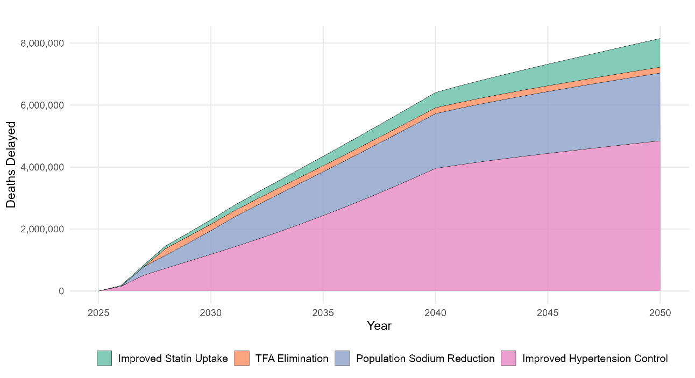{width="5.87in"}

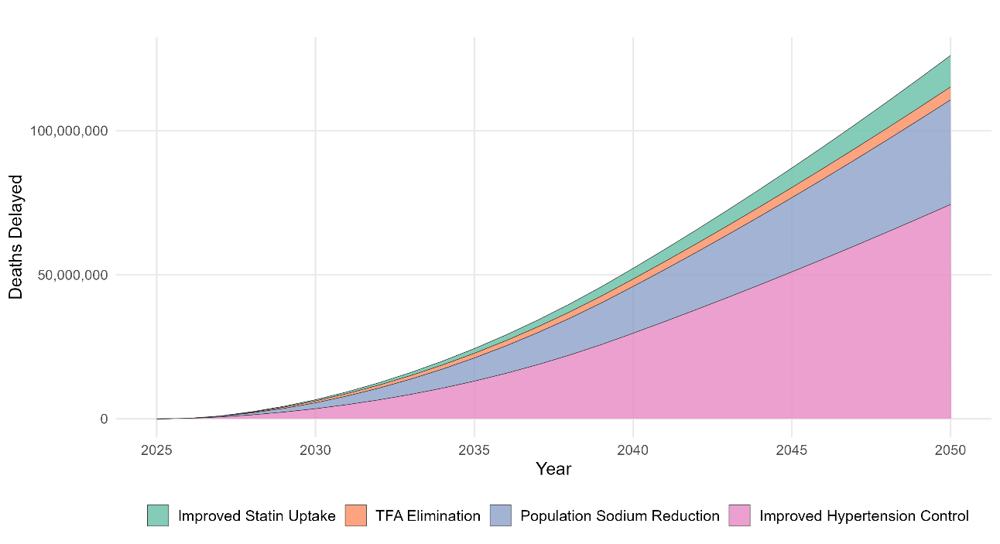{width="5.87in"}

Figure 1 Notes: Stacked area plots show the impact of each of the four interventions compared with business-as-usual. The top panel presents annual deaths delayed, while the bottom panel shows cumulative deaths delayed over time. Results are for the adult population aged 20+.

```{=openxml}
<w:p><w:r><w:br w:type="page"/></w:r></w:p>
```

**Figure 2 Deaths that could be delayed by sex, age, and intervention, 2026-2050**

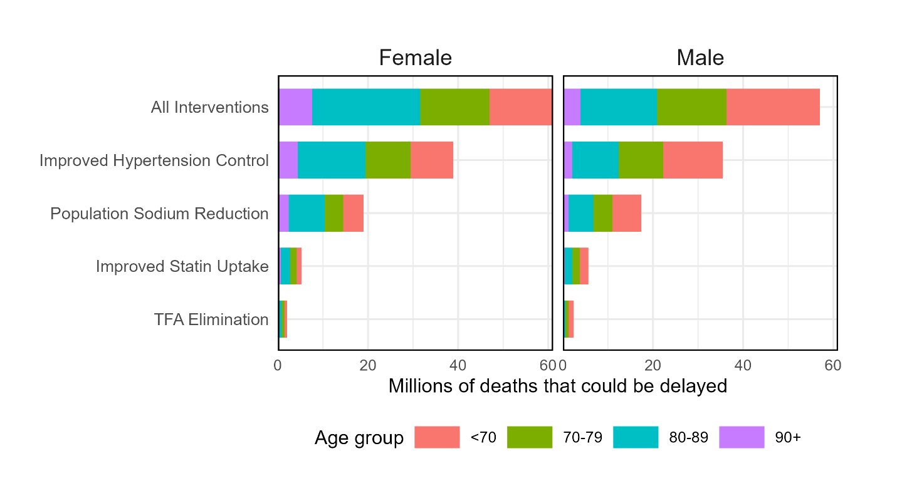{width="6.5in"}

Figure 2 Notes: Deaths from the adult population aged 20+.

```{=openxml}
<w:p><w:r><w:br w:type="page"/></w:r></w:p>
```


**Figure 3 Proportion of Deaths Delayed by Country and Sex Compared to the Business-as-Usual Scenario (2026–2050)**

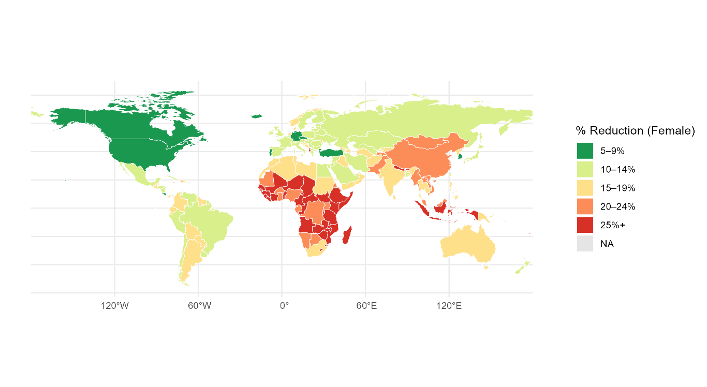{width="6.2in"}

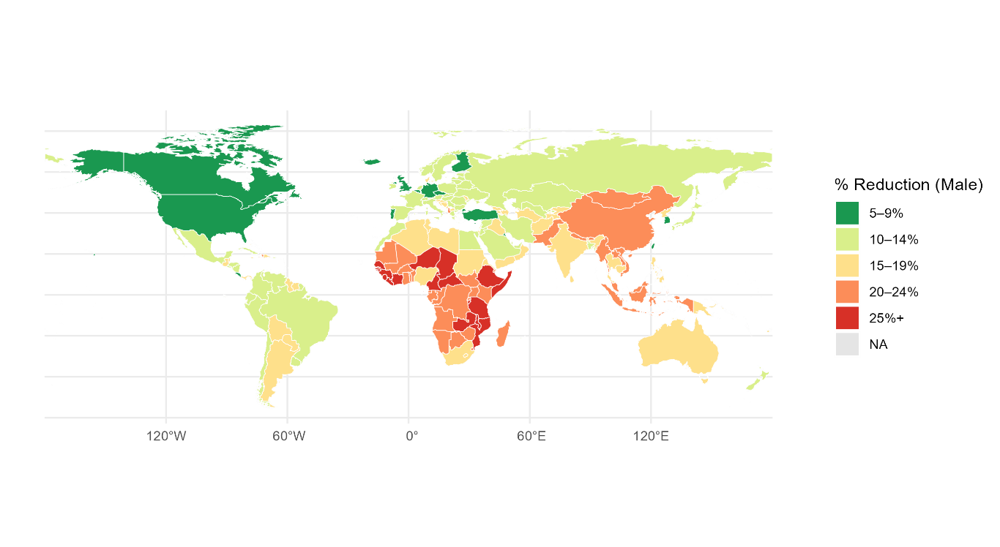{width="6.2in"}

Figure 3 Notes: Maps show the percentage reduction in cardiovascular deaths under the combined intervention scenario relative to the business-as-usual comparator. Results are presented separately for females (top) and males (bottom). The combined intervention includes scale-up of hypertension control, population sodium reduction, elimination of industrially-derived produced trans fats, and increased statin uptake for cardiovascular risk reduction.

```{=openxml}
<w:p><w:r><w:br w:type="page"/></w:r></w:p>
```

**Figure 4 Deaths that could be delayed by sex, age, region and intervention, 2026-2050**

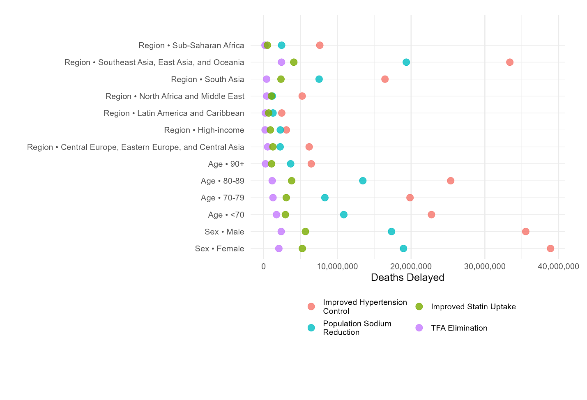{width="6.5in"}

Figure 4 Notes: Cardiovascular deaths that could be delayed under each intervention scenario from the adult population aged 20+.

```{=openxml}
<w:p><w:r><w:br w:type="page"/></w:r></w:p>
```

# Supplemental material

## Countries and scenarios

```{r tableS1}
ts1 <- read_tab("TS1_Regions")
show_tab(ts1, caption = "**Table S1. List of countries in each region.**")
```

Table S1 Notes: Countries were grouped into seven geographic regions following the World Bank's income and geographic grouping system.

```{=openxml}
<w:p><w:r><w:br w:type="page"/></w:r></w:p>
```

**Figure S1 Risk Factor Trajectories for Each Country Under Intervention Scenario, 2026-2050**

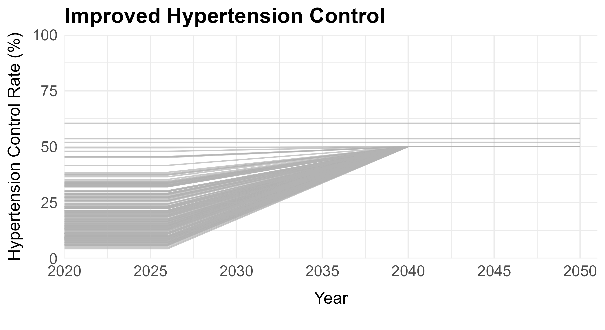{width="2.75in"} 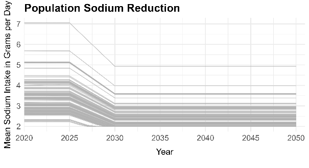{width="2.75in"}

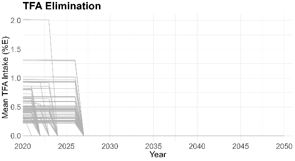{width="2.75in"} 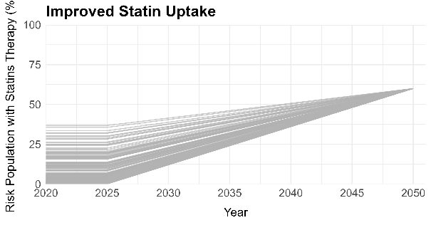{width="2.75in"}

Figure S1 Notes: Spaghetti plots show country-specific baseline levels and projected implementation dynamics for four intervention scenarios: (A) Improved Hypertension Control, (B) Population Sodium Reduction, (C) elimination of industrial TFAs, and (D) Improved Statin Uptake. Each line represents one country, illustrating heterogeneity in baseline exposure levels and the gradual convergence toward intervention targets over the period from 2026 to 2050.

```{=openxml}
<w:p><w:r><w:br w:type="page"/></w:r></w:p>
```

**Figure S2 Required scale-up in hypertension control and historical year-to-year changes in the hypertension care cascade**

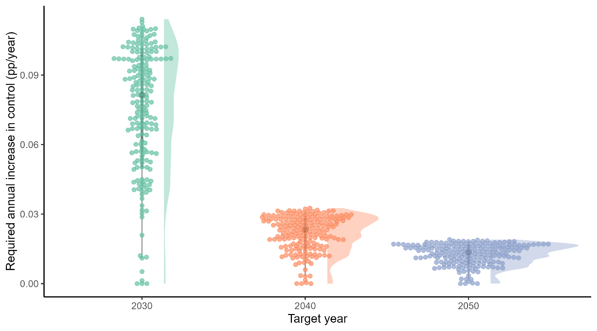{width="5.58in"}

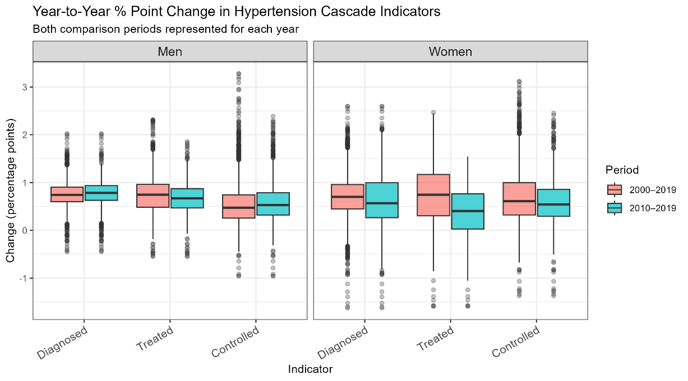{width="5.58in"}

Figure S2 Notes: This figure contrasts the pace of hypertension control improvement required to achieve 50% population-level control by 2030, 2040, or 2050 with the pace historically observed across countries. The upper panel shows country-specific required average annual increases in control (percentage points per year) under a linear scale-up from baseline levels, with overlaid density distributions summarizing cross-country variation. The lower panels show historical year-to-year percentage-point changes in diagnosis, treatment, and control, stratified by sex using data from NCD-RisC 2000-2019 [@Zhou2021].

```{=openxml}
<w:p><w:r><w:br w:type="page"/></w:r></w:p>
```

## Calibration and validation

**Figure S3 Age-Standardized Mortality Rates by Cause Intervention Scenario, 2000-2050**

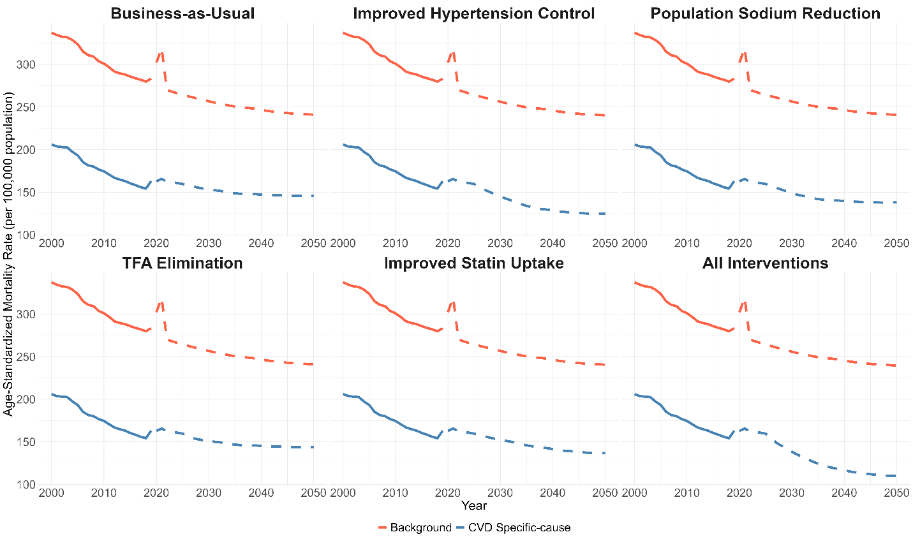{width="6.5in"}

Figure S3 Notes: Trends in age-standardized mortality rates per 100,000 population from 2000 to 2050 under alternative intervention scenarios. Solid lines represent observed or modeled baseline trends through 2019; dashed lines represent projections from 2020 onward. Blue lines show cause-specific mortality (IHD, stroke, hypertensive heart disease), and red lines show background mortality. Standardized using the WHO World Standard Population (2000–2025), rescaled to ages 20–95+. The bump in 2020 is due to COVID-19.

```{=openxml}
<w:p><w:r><w:br w:type="page"/></w:r></w:p>
```

**Figure S4 Comparison of Mortality Estimates and Forecasts vs GBD 2019 Foresight, 2000-2050**

{width="5.5in"}

{width="5.5in"}

Figure S4 Notes: Age-standardized mortality rate indices (top) and absolute deaths (bottom) are shown for hypertensive heart disease, intracerebral hemorrhage, ischemic heart disease, and ischemic stroke, ages 20–95+, both sexes combined. Results from this study (blue) are compared with GBD 2019 Foresight projections (red). Differences reflect alternative assumptions about secular trends and intervention effects.

**Validation:** We further validated our projections against UN-WPP all-cause mortality estimates and GBD 2019 foresight projections for cause-specific mortality (Supplemental material Figures). Under the business-as-usual scenario, we project approximately 34 million global deaths from the CVD causes studied by 2050—higher than the 23 million projected in GBD foresight, reflecting differences in secular trend assumptions. Nonetheless, our estimates total deaths projections closely track UN-WPP all-cause mortality (87.4 million) and align with an independent estimate of 35.6 million CVD deaths by 2050 [@Chong2024], providing confidence in the validity of our model outputs.

```{=openxml}
<w:p><w:r><w:br w:type="page"/></w:r></w:p>
```

**Figure S5 Comparison of Global Death Estimates and Projections by Sex: Current Study vs UN-WPP 2024, 2000–2050**

{width="6.5in"}

Figure S5 Notes: Trends in total global deaths for females (left) and males (right), comparing all-cause estimates from this study (solid lines, 2000–2019; dashed lines, 2020–2050) with those from the UN-WPP 2024.

```{=openxml}
<w:p><w:r><w:br w:type="page"/></w:r></w:p>
```

## Comparison to previous work

Our estimates are broadly similar to those of Kontis et al. [-@Kontis2019] and Pickersgill et al. [-@Pickersgill2022] but with some notable differences for specific interventions and countries. **Table S2** summarizes the results from this study (first column) in comparison with previous modeling analyses by Kontis et al. (third column) and Pickersgill et al. (final column). The second column, "This study – Kontis methods" shows the results of a mini replication study we did, where we used the same modeling methods and scenarios as in the Kontis et al. paper but with updated inputs (eg, GBD 2023) and a 2026-2050 time horizon. **Table S3** presents the results (for all four interventions combined) for the 15 countries with the largest cumulative impact from the interventions.

Our 2026–2050 estimate for the four-intervention package (118.1 million deaths delayed) is 25% higher than the three-intervention package analyzed by Kontis et al. (94.3 million) and 33% higher than the two-intervention package analyzed by Pickersgill et al. (88.5 million). Country patterns are directionally consistent but differ in magnitude: we project larger gains for China (39.9 million vs. 19.1 million Kontis; 27 million Pickersgill) and India (19.5 million vs. 16.7 million; 12 million), similar values for Bangladesh, and more minor effects than Kontis et al. in several high-income settings with high performance in hypertension control and thus small or null scaling up (e.g., United States 1.1 million vs. 3.7 million).

There are three key differences between the two analyses that are worth bearing in mind:

1.  We model the natural history of CVD, including nonfatal events, and therefore attempt to capture disease dynamics beyond a shift in mortality rates; further, most of the impact of our interventions is on reducing CVD incidence, which then translates into lower mortality rates over time
2.  We assume that interventions take time to implement to reach full scale; when compared with Kontis et al., we find a smaller number of deaths delayed during the first few years of our analytic time horizon
3.  We look at the period 2025-2050, compared to 2015-2040 in Kontis et al. The difference in baseline population size and structure between these two time horizons is nontrivial; there are more individuals and more all-cause and CVD-specific deaths over 2025-2050 compared to 2015-2040 and therefore a larger number of deaths delayed for a given relative risk reduction (see **Table S2**).

**Table S4** provides a more detailed comparison of methods and data between the two studies. Key differences by intervention are summarized below.

***Improved hypertension control:*** The first and most important difference is that we model the impact of achieving 50% population blood pressure control as opposed to providing blood pressure treatment. This means that, instead of shifting the population mean SBP (as in Kontis et al), we reduce SBP to \<140 (non-diabetic) or \<130 (diabetic) for individuals with raised BP. Practically, this means that the "tail" of the SBP distribution (ie, persons with severe hypertension) are receiving more benefits from our version of the hypertension intervention than they would in the Kontis et al. version of the intervention. This difference in modeling accounts for most of the difference in aggregate results. As per **Table S2**, we replicated the Kontis et al. hypertension analysis using our more-recent input data and found 41 million lives saved, as compared to the 74.4 million in our analysis. The difference between the two is the result of the more ambitious blood pressure intervention.

Second, our impact estimates are driven by rate ratios for blood pressure reduction at different starting levels of SBP, as per a meta-analysis of clinical trials by Ettehad et al. Again, this leads to large relative risk reductions for individuals at the tail of the SBP distribution who are at very high risk and both (a) drive population-average CVD incidence rates and (b) have the most to benefit from getting their hypertension controlled. It deviates from Kontis et al., who use the population-attributable fraction approach and relative risks (at different SBP levels) from observational studies to estimate treatment impact.

Third, we scale up blood pressure control from its current level, which varies by country to the target of 50% by 2040, then maintain blood pressure control at 50% through 2050 to capture delayed effects of hypertension treatment. The 50% target was chosen to be aspirational but feasible based on experience from high-performing countries like South Korea and Canada. We use SBP distributions and hypertension prevalence data from the NCD Risk Factor Collaboration, which is updated from the dataset used by Kontis et al.

***Population sodium reduction:*** All else equal, our impact estimates are modestly lower than found in our replication of the Kontis et al. methods using our input data. This is because we phase in sodium reduction over a few years, and its primary effect in our model is a reduction in the incidence of CVD that translates over time into lower population mortality rates. (By contrast, Kontis et al. model an instantaneous reduction in CVD-specific mortality rates from lower sodium consumption.) While we use newer meta-analysis estimates for our sodium reduction effect sizes, the average reductions in SBP are broadly similar between the two analyses.

Comparing our input data to Kontis et al., mean sodium intake for most countries is similar. However, China is a very large and notable exception: its GBD 2023 estimates, which were used in our analysis, are about 40% higher than its GBD 2010 estimates, which were used by Kontis et al. When considering both this larger potential reduction in sodium and a more ambitious hypertension intervention, we find nearly twice as many deaths delayed in China compared with Kontis et al. (**Table S3** below). Kontis et al. estimated 19 million deaths delayed in China, but with our input data (including higher sodium consumption and a slightly larger/older population), they would have found about 32 million deaths delayed. When the differences in hypertension modeling methods are considered that number would increase to 39.9 million. Further, in our analysis, China accounts for roughly 40% of the global impact of sodium reduction, a finding we will highlight in our manuscript.

***Industrial TFA elimination:*** The main difference between our analysis and Kontis et al. is that, since their study, numerous countries have implemented bans on industrial TFA. Therefore, the future impact of implementing bans will be smaller than it was in 2017. Kontis et al. found around 15 million deaths could be delayed over 25 years from TFA bans, whereas our replication of Kontis using current policy implementation data finds just over 4.5 million over 24 years. The implication is that countries that have put in place TFA bans since 2017 account for about 10 million potential deaths delayed over the next couple of decades, a significant public health success. In particular, India represents about 4 million deaths that were accounted in Kontis before the ban and are not counted in this study since the country implemented the ban before 2025.

***Improved statin uptake:*** This intervention was not considered in any of the previous analyses and is included here for the first time. Statins account for about 11 million deaths delayed as compared to the 74 million deaths delayed from better hypertension control. However, the comparison is imperfect because we only consider primary prevention statins among persons with diabetes. The pool of individuals eligible for primary prevention statins is substantially larger than this, but it is outside the scope of this study to explore different eligibility thresholds or the feasibility of scaling up statins compared to antihypertensive drugs.

```{=openxml}
<w:p><w:r><w:br w:type="page"/></w:r></w:p>
```

```{r tableS2}
fmt_comp <- function(df) {
  out <- data.frame(df[[1]], lapply(df[-1], fmt_num, d = 1), check.names = FALSE)
  names(out) <- c(names(df)[1],
                  "This study 2026\u20132050", "This study \u2013 Kontis methods 2026\u20132050",
                  "Kontis et al. 2015\u20132040", "Pickersgill et al. 2022\u20132050")
  out
}
ts2 <- fmt_comp(read_tab("TS2_CompareIntervention"))
ts2 <- bold_rows(ts2, which(ts2$Intervention == "All Interventions"))
show_tab(ts2, caption = "**Table S2. Estimated Deaths Delayed (Millions) From Scalable Cardiovascular Prevention Interventions: Comparison With Prior Global Modeling Studies by intervention**",
         align = c("l", rep("r", 4)))
```

Table S2 Notes: Estimated deaths delayed between 2026 and 2050 from this study are compared with previous modeling analyses by Kontis et al. (2015–2040) and Pickersgill et al. (2022–2050) across selected interventions. Differences reflect variances in interventions, trends in risk factors, and modeling assumptions. The red column shows the results of this study if we used the same blood pressure, sodium reduction, and TFA methods and scenarios.

```{=openxml}
<w:p><w:r><w:br w:type="page"/></w:r></w:p>
```

```{r tableS3}
ts3 <- fmt_comp(read_tab("TS3_CompareCountry"))
show_tab(ts3, caption = "**Table S3. Estimated Deaths Delayed (Millions) From Scalable Cardiovascular Prevention Interventions: Comparison With Prior Global Modeling Studies by selected countries**",
         align = c("l", rep("r", 4)))
```

Table S3 Notes: Estimated deaths delayed between 2026 and 2050 from this study are compared with previous modeling analyses by Kontis et al. (2015–2040) and Pickersgill et al. (2022–2050) across selected countries that accumulate approximately 70% of deaths delayed. Differences reflect variances in interventions, trends in risk factors, and modeling assumptions. The red column shows the results of this study if we used the same blood pressure, sodium reduction, and TFA methods and scenarios.

```{=openxml}
<w:p><w:r><w:br w:type="page"/></w:r></w:p>
```

```{r tableS4}
ts4 <- read_tab("TS4_ModelCompare")
show_tab(ts4, caption = "**Table S4. Comparison of Modeling Approaches: This study vs Kontis et. al 2019**",
         widths = c(0.17, 0.37, 0.25, 0.21))
```

Table S4 Notes: Comparison of Modeling Approaches.

```{=openxml}
<w:p><w:r><w:br w:type="page"/></w:r></w:p>
```

## Additional results

```{r tableS5}
ts5 <- read_tab("TS5_Premature_Sex")
ts5_out <- data.frame(
  "Intervention" = ts5[[1]],
  "Sex" = blank_repeats(ts5[[2]]),
  "Deaths Delayed (#)" = fmt_int(ts5[[3]]),
  "Deaths Delayed (<70 years %)" = fmt_pct(ts5[[4]], 1),
  check.names = FALSE)
ts5_out <- bold_rows(ts5_out, which(ts5$Intervention == "All Interventions"))
show_tab(ts5_out, caption = "**Table S5. Premature deaths (<70 years) by intervention and sex, 2025\u20132050**",
         align = c("l", "l", "r", "r"))
```

Table S5 Notes: Deaths delayed are calculated as the difference in cumulative deaths between the business-as-usual scenario and each intervention scenario. Deaths delayed (\<70 years %) indicate the proportion of all deaths delayed under the corresponding intervention and sex that occur before age 70 years, not the share of baseline deaths.

```{=openxml}
<w:p><w:r><w:br w:type="page"/></w:r></w:p>
```


```{r tableS6}
ts6 <- read_tab("TS6_Premature_Top30")
ts6_out <- data.frame(
  "Location" = ts6[[1]],
  "Projected Deaths Delayed <70 years" = fmt_int(ts6[[2]]),
  "Share of delayed deaths occurring <70 years (%)" = fmt_pct(ts6[[3]], 1),
  check.names = FALSE)
show_tab(ts6_out, caption = "**Table S6. Premature deaths delayed (<70 years) in the 30 most populous countries under combined interventions, 2025\u20132050**",
         align = c("l", "r", "r"))
```

Table S6 Notes: % deaths delayed \<70 represents the proportion of all deaths delayed in each country that occur before age 70 years, serving as an indicator of the share of benefits attributable to premature mortality reduction.

```{=openxml}
<w:p><w:r><w:br w:type="page"/></w:r></w:p>
```

```{r tableS7}
ts7 <- read_tab("TS7_ByCountry")   # the Region column is kept in the workbook for tracking only
ts7_out <- data.frame(
  "Location" = ts7[["Location"]],
  "Projected Deaths" = fmt_int(ts7[["Projected Deaths"]]),
  "Baseline Deaths" = fmt_int(ts7[["Baseline Deaths"]]),
  "Deaths Delayed" = fmt_int(ts7[["Deaths Delayed"]]),
  "Deaths Delayed per Year" = fmt_int(ts7[["Deaths Delayed per Year"]]),
  "% Delayed" = fmt_pct(ts7[["% Delayed"]], 0),
  check.names = FALSE)
show_tab(ts7_out, caption = "**Table S7. Projected CVD deaths, number of deaths delayed, and percent deaths delayed between 2026 and 2050 if all the interventions were implemented, by country.**",
         align = c("l", rep("r", 5)))
```

```{=openxml}
<w:p><w:r><w:br w:type="page"/></w:r></w:p>
```

## Sensitivity analysis

```{r tableS8}
ts8 <- read_tab("TS8_Sensitivity")
ts8_out <- data.frame(
  "Mortality Trend Modeling" = esc_md(blank_repeats(ts8[[1]])),
  "Intervention" = ts8[[2]],
  "Projected Deaths" = fmt_num(ts8[[3]], 1),
  "Baseline Deaths" = ifelse(duplicated(ts8[[1]]), "", fmt_num(ts8[[4]], 1)),
  "Deaths Delayed" = fmt_num(ts8[[5]], 1),
  "Deaths Delayed per Year" = fmt_num(ts8[[6]], 1),
  "Deaths Delayed (%)" = fmt_num(100 * ts8[[7]], 1),
  check.names = FALSE)
show_tab(ts8_out, caption = "**Table S8. Background and CVD mortality trends sensitivity scenarios on million deaths that could be delayed by intervention, 2026-2050**",
         align = c("l", "l", rep("r", 5)))
```

Table S8 Notes: Projected deaths delayed (2026–2050) are shown under alternative assumptions for secular background and cardiovascular mortality trends, with results reported for individual interventions and their combined effects.

```{=openxml}
<w:p><w:r><w:br w:type="page"/></w:r></w:p>
```

## Model assumptions and mathematical details

```{r tableS9}
ts9 <- read_tab("TS9_Assumptions")
show_tab(ts9, caption = "**Table S9. Structural Assumptions in the State-Transition Models**")
```

Table S9 Notes: We used discrete-time Markov models stratified by single-year age (20–95+), sex, and calendar year (2019–2050). Interventions were assumed to be independent except for sodium reduction, which was linked to blood pressure and its downstream effects. Combined effects were applied multiplicatively to avoid double-counting and provide conservative estimates of joint impact.

```{=openxml}
<w:p><w:r><w:br w:type="page"/></w:r></w:p>
```

## Mathematical model detailed description

### Hypertension Control Intervention Model

The model quantifies the impact of scaling up antihypertensive treatment on cardiovascular disease incidence and case fatality. It integrates three key components:

* **GBD relative risks** to establish baseline disease burden by blood pressure category
* **Trial effect sizes** to model treatment impact accounting for diabetes prevalence
* **Linear scale-up** from baseline to target control rates over a specified period

Throughout this section, we reserve the notation $\varepsilon$ for multiplicative effect ratios applied directly to transition rates, while all coverage-adjusted quantities and reduction factors are treated as intermediate components used to construct these ratios.

#### Input Parameters

##### Baseline Data (t=0)

* $IR_{a,s,c}$: Incidence rate for age $a$, sex $s$, and cause $c$
* $CF_{a,s,c}$: Case fatality rate
* $P(\text{BP}_{\text{cat}})$: Probability distribution across BP categories
* $N_{a,s,t}$: Population size by age, sex, and year $t$

##### Treatment Parameters

* $C_{\text{baseline}}$: Baseline control rate (proportion with BP \<140/90 among treated hypertensives)
* $C_{\text{target}}$: Target control rate
* $T_{\text{start}}$: Scale-up start year (default: 2025)
* $T_{\text{end}}$: Target achievement year (default: 2050)

##### Blood Pressure Categories

The model uses eight BP categories (in mmHg):

<120, 120-129, 130-139, 140-149, 150-159, 160-169, 170-179, 180+

**Hypertensive bins** (eligible for treatment): 140-149, 150-159, 160-169, 170-179, 180+ mmHg

#### Step 1: Baseline BP Distribution

Obtain BP probability distribution without treatment intervention:

$$P(\text{BP}_{\text{cat}} \mid a, s, t) = \text{get.bp.prob}(\text{rx}=0)$$

This represents the natural BP distribution in the population before any treatment scale-up.

#### Step 2: Baseline Incidence by BP Category

Calculate cause-specific incidence for each BP bin using GBD relative risks.

**GBD Relative Risk (per 10 mmHg increase)**

$$RR_{\text{GBD}}(\text{BP}_{\text{cat}}, a, c) = RR_{\text{per10mmHg}}^{\Delta/10}$$

where $\Delta = \text{BP}_{\text{midpoint}} - 120$ mmHg (reference category).

**Normalization Factor**

$$\alpha_{a,s,c,t} = \sum_{\text{BP}_{\text{cat}}} \left[ P(\text{BP}_{\text{cat}}) \times RR_{\text{GBD}}(\text{BP}_{\text{cat}}, a, c) \right]$$

**Bin-Specific Baseline Incidence**

$$IR_{\text{bin}}(\text{BP}_{\text{cat}}, a, s, c, t) = \frac{RR_{\text{GBD}}(\text{BP}_{\text{cat}}, a, c) \times IR_{a,s,c}}{\alpha_{a,s,c,t}}$$

#### Step 3: Trial Effect Sizes

Calculate diabetes-weighted effect size for BP reduction in each bin.

**Diabetes-Weighted Effect**

$$E_{\text{trial}}(\text{BP}_{\text{cat}}, c, d) = (1-w_{\text{DM}}) \times E_{\text{noDM}} + w_{\text{DM}} \times E_{\text{DM}}$$

where $w_{\text{DM}}$ = diabetes proportion (default: 0.1), and $E$ values are from Ettehad trials meta-analysis.

#### Step 4: Coverage Scale-Up

Model linear increase in treatment coverage above baseline. The implementation ensures that only the *incremental* coverage above baseline is scaled up, preventing double-counting of existing treatment effects.

##### Incremental Coverage Target

$$\Delta C_{\text{target}} = \max(C_{\text{target}} - C_{\text{baseline}}, 0)$$

This represents the additional coverage to be achieved above the existing baseline control rate.

##### Time-Varying Incremental Coverage

The model first calculates the scale-up trajectory *as if* baseline were zero, then adds baseline coverage:

$$\Delta C_{\text{increment}}(t) = \Delta C_{\text{target}} \times \min\left[\frac{t - T_{\text{start}}}{T_{\text{end}} - T_{\text{start}}}, 1\right]$$

**Boundary conditions for incremental coverage:**

* For $t < T_{\text{start}}$: $\Delta C_{\text{increment}}(t) = 0$
* For $T_{\text{start}} \leq t \leq T_{\text{end}}$: Linear interpolation
* For $t > T_{\text{end}}$: $\Delta C_{\text{increment}}(t) = \Delta C_{\text{target}}$

##### Coverage at Time t (Baseline and Current)

For hypertensive BP bins, two coverage values are tracked:

$$C_0(\text{BP}_{\text{cat}}) = C_{\text{baseline}} \quad \text{(baseline coverage)}$$

$$C_t(t, \text{BP}_{\text{cat}}) = C_{\text{baseline}} + \Delta C_{\text{increment}}(t) \quad \text{(current coverage)}$$

where $\text{BP}_{\text{cat}} \in \{$140-149, 150-159, 160-169, 170-179, 180+$\}$.

For non-hypertensive BP bins (\<140 mmHg), coverage is always zero:

$$C_0(\text{BP}_{\text{cat}}) = C_t(t, \text{BP}_{\text{cat}}) = 0 \quad \text{if } \text{BP}_{\text{cat}} \notin \text{hypertensive bins}$$

#### Step 5: Coverage-Adjusted Effect Sizes

Apply incremental coverage to trial effect sizes:

$$E_{\text{adjusted}}(t) = \frac{E_{\text{trial}} \times (C(t) - C_{\text{baseline}})}{1 - E_{\text{trial}} \times C_{\text{baseline}}}$$

**Special case:** If $C_{\text{baseline}} = 0$ (no prior treatment), simplifies to:

$$E_{\text{adjusted}}(t) = E_{\text{trial}} \times C(t)$$

#### Step 6: New Bin-Specific Incidence

Apply coverage-adjusted effect to each BP bin:

$$IR_{\text{bin,new}}(\text{BP}_{\text{cat}}, a, s, c, t) = IR_{\text{bin}}(\text{BP}_{\text{cat}}) \times [1 - E_{\text{adjusted}}(t, \text{BP}_{\text{cat}}, c)]$$

#### Step 7: Population-Weighted Incidence

Aggregate across BP bins using baseline population distribution:

$$IR_{\text{new}}(a, s, c, t) = \sum_{\text{BP}_{\text{cat}}} \left[ IR_{\text{bin,new}}(\text{BP}_{\text{cat}}) \times P(\text{BP}_{\text{cat}}) \right]$$

#### Step 8: Incidence Effect Ratio

The incidence intervention effect is summarized as a multiplicative incidence effect ratio, defined as the proportional change in the cause-specific incidence rate induced by improved blood pressure control:

$$\varepsilon_{IR}(a, s, c, t) = \frac{IR_{\text{new}}}{IR_{\text{original}}}$$

This ratio is the sole estimand passed to the state transition model to modify baseline incidence rates. Values of $\varepsilon_{IR} < 1$ indicate reductions in disease incidence attributable to the intervention.

#### Step 9: Case Fatality Reduction

Case fatality reductions are modeled using intermediate proportional reductions based on incremental hypertensive coverage above baseline. These intermediate quantities are used to construct a multiplicative case-fatality effect ratio, ensuring that pre-existing treatment effects embedded in baseline case fatality rates are not double-counted.

##### Incremental Coverage Delta

First, calculate the incremental coverage change for each individual:

$$\Delta C_{\text{delta}}(t, \text{BP}_{\text{cat}}) = \max(C_t(t, \text{BP}_{\text{cat}}) - C_0(\text{BP}_{\text{cat}}), 0)$$

This represents only the *new* coverage achieved through the intervention, not the pre-existing baseline coverage.

##### Aggregate Hypertensive Coverage

Calculate the population-weighted average of incremental coverage across hypertensive BP bins:

$$C_{\text{agg}}^{\Delta}(a, s, c, t) = \frac{\sum_{\text{BP}_{\text{cat}} \in \text{hypertensive bins}} [\Delta C_{\text{delta}}(t, \text{BP}_{\text{cat}}) \times P(\text{BP}_{\text{cat}})]}{\sum_{\text{BP}_{\text{cat}} \in \text{hypertensive bins}} P(\text{BP}_{\text{cat}})}$$

The calculation is restricted to hypertensive bins only (BP $\geq$ 140 mmHg), as these are the bins eligible for treatment.

##### CF Reduction Factors

| Cause | CF Reduction Factor ($\rho_{CF}$) |
|-------|-----------------------------------|
| IHD | 0.24 |
| Ischemic stroke | 0.36 |
| Hemorrhagic stroke | 0.76 |
| HHD | 0.20 |

Table: Case fatality reduction factors per unit control

##### New Case Fatality

Apply the CF reduction using only the incremental coverage:

$$CF_{\text{new}}(a, s, c, t) = CF_{\text{original}} \times [1 - \rho_{CF,c} \times C_{\text{agg}}^{\Delta}(a, s, c, t)]$$

where $\rho_{CF,c}$ is the cause-specific CF reduction factor and $C_{\text{agg}}^{\Delta}$ is the *incremental* aggregate coverage. The term $\rho_{CF,c} \times C_{\text{agg}}^{\Delta}$ represents an intermediate proportional reduction in case fatality, not the estimand itself.

#### Step 10: Case Fatality Effect Ratio

The overall effect of antihypertensive treatment on disease-specific mortality is summarized as a multiplicative case-fatality effect ratio:

$$\varepsilon_{CF}(a, s, c, t) = \frac{CF_{\text{new}}}{CF_{\text{original}}}$$

This ratio is the estimand applied to baseline case fatality rates in the state transition model.

#### Effect Ratios

The antihypertensive intervention produces two multiplicative effect ratios, which are the only quantities used to modify baseline transition rates in the state transition model:

##### Incidence Effect Ratio

$$\varepsilon_{IR,\text{BP}}(a, s, c, t) = \frac{IR_{\text{new}}(a, s, c, t)}{IR_{\text{original}}(a, s, c, t)}$$

This ratio is applied to baseline incidence rates in the state transition model. Values less than 1 indicate reduction in disease incidence due to improved BP control.

##### Case Fatality Effect Ratio

$$\varepsilon_{CF,\text{BP}}(a, s, c, t) = \frac{CF_{\text{new}}(a, s, c, t)}{CF_{\text{original}}(a, s, c, t)}$$

This ratio is applied to baseline case fatality rates. Values of $\varepsilon_{CF,\text{BP}} < 1$ indicate improved survival among individuals with disease due to antihypertensive treatment. These outputs feed into the state transition model to project disease burden under treatment scale-up scenarios.

### Sodium Reduction Intervention Model

The sodium reduction intervention uses the same trial framework as antihypertensive therapy, but applies effects through blood pressure reduction achieved via dietary sodium intake changes.

#### Overview

Sodium reduction operates through:

* Linear scale-up of sodium intake reduction from baseline to target
* Filippini dose-response relationship: BP reduction per gram of sodium reduced
* Ettehad effect sizes applied based on achieved BP reduction
* No direct effect on case fatality (only through incidence reduction)

#### Input Parameters

* $S_{\text{current}}$: Current sodium intake (grams/day)
* $S_{\text{eff}}$: Sodium reduction parameter
* $S_{\text{method}}$: Reduction method (percent, target, or absolute)
* $T_{\text{salt,start}}$: Intervention start year (default: 2025)
* $T_{\text{salt,end}}$: Full implementation year (default: 2030+)
* $\phi_{\text{hyp}}$: Proportion with raised BP (hypertensive individuals)

#### Sodium Reduction Target Calculation

Based on reduction method:

$$S_{\text{target}} = \begin{cases}
S_{\text{current}} \times S_{\text{eff}} & \text{if method = "percent"} \\
\min(S_{\text{current}}, S_{\text{eff}}) & \text{if method = "target"} \\
\max(0, S_{\text{current}} - S_{\text{eff}}) & \text{if method = "app"}
\end{cases}$$

**Minimum intake constraint:** If $S_{\text{current}} - S_{\text{target}} < 2$ grams/day, the model enforces a minimum intake floor: $S_{\text{target}} = S_{\text{current}} - 2$.

#### Time-Varying Sodium Reduction

Linear scale-up of sodium reduction:

$$S_{\text{reduction}}(t) = \begin{cases}
0 & \text{if } t < T_{\text{salt,start}} \\
S_{\text{target}} \times \frac{t - T_{\text{salt,start}} + 1}{T_{\text{salt,end}} - T_{\text{salt,start}} + 1} & \text{if } T_{\text{salt,start}} \leq t \leq T_{\text{salt,end}} \\
S_{\text{target}} & \text{if } t > T_{\text{salt,end}}
\end{cases}$$

#### Dose-Response: SBP Reduction

Blood pressure reduction from sodium intake reduction:

$$\Delta SBP(a, s, t) = [2.8 \times \phi_{\text{hyp}}(a,s) + 1.0 \times (1 - \phi_{\text{hyp}}(a,s))] \times S_{\text{reduction}}(t)$$

where:

* 2.8 mmHg reduction per gram for hypertensive individuals
* 1.0 mmHg reduction per gram for normotensive individuals

#### Trial Effect Size for Sodium-Mediated BP Reduction

The sodium-mediated effect on incidence uses Ettehad relative risks:

$$E_{\text{sodium}}(\text{BP}_{\text{cat}}, c, a, s, t) = (1 - RR_{\text{trial},c,\text{BP}_{\text{cat}}}) \times 0.1 \times \Delta SBP(a, s, t)$$

This represents the proportional reduction in disease risk for each mmHg of BP reduction (scaled by 0.1 for per-mmHg effect).

#### Modified Incidence

Sodium reduction affects disease burden exclusively through reductions in incidence, mediated by blood pressure lowering. At the BP-bin level, sodium-induced blood pressure changes generate an intermediate proportional reduction in incidence, denoted $E^{IR}_{\text{sodium}}(a,s,c,t,\text{BP}_{\text{cat}})$.

$$IR_{\text{bin,sodium}}(\text{BP}_{\text{cat}}, a, s, c, t) = IR_{\text{bin}}(\text{BP}_{\text{cat}}, a, s, c, t) \times \left[1 - E^{IR}_{\text{sodium}}(a,s,c,t,\text{BP}_{\text{cat}})\right]$$

$$IR_{\text{new}}(a, s, c, t) = \sum_{\text{BP}_{\text{cat}}} IR_{\text{bin,sodium}}(\text{BP}_{\text{cat}}, a, s, c, t) \times P(\text{BP}_{\text{cat}})$$

#### Case Fatality

Sodium reduction has no direct secondary effect on case fatality in this model:

$$CF_{\text{new}} = CF_{\text{original}}, \quad \varepsilon_{CF} = 1$$

Accordingly, the sodium intervention generates no case-fatality effect ratio and modifies mortality exclusively through reductions in disease incidence.

#### Effect Ratios

The sodium reduction intervention is summarized by a single multiplicative incidence effect ratio, which is the sole quantity passed to the state transition model:

**Incidence Effect Ratio**

$$\varepsilon_{IR,\text{sodium}}(a, s, c, t) = \frac{IR_{\text{new}}(a, s, c, t)}{IR_{\text{original}}(a, s, c, t)}$$

This ratio captures the reduction in disease incidence achieved through sodium-mediated blood pressure lowering. Values less than 1 indicate incidence reduction.

**Case Fatality Effect Ratio**

$$\varepsilon_{CF,\text{sodium}}(a, s, c, t) = 1 \quad \text{(no direct effect)}$$

Sodium intervention has no modeled secondary effect on case fatality, only on incidence through BP reduction.

### Trans Fat (TFA) Policy Intervention Model

The TFA policy intervention models the impact of reducing industrial trans fatty acid intake on ischemic heart disease mortality.

#### Overview

TFA policy operates through:

* Age-specific relative risks per 1% of energy from trans fats
* Instantaneous policy implementation (no gradual scale-up)
* Effect only on **case fatality** of IHD (no effect on incidence)
* Based on GBD risk factor attribution

#### Input Parameters

* $TFA_{\text{current}}(t)$: Current trans fat intake (% of total energy)
* $TFA_{\text{target}}$: Target trans fat intake (typically 0)
* $T_{\text{TFA,start}}$: Policy start year (default: 2027)

#### TFA Exposure Reduction

$$\Delta TFA(t) = \begin{cases}
0 & \text{if } t < T_{\text{TFA,start}} \\
\max(TFA_{\text{current}}(t) - TFA_{\text{target}}, 0) & \text{if } t \geq T_{\text{TFA,start}}
\end{cases}$$

#### Age-Specific Relative Risks

Relative risk per 1% of energy from trans fats [@Wang2016]:

| Age Group | RR per 1% |
|-----------|-----------|
| 20-24 | 1.21 |
| 25-29 | 1.20 |
| 30-34 | 1.19 |
| 35-39 | 1.18 |
| 40-44 | 1.17 |
| 45-49 | 1.16 |
| 50-54 | 1.15 |
| 55-59 | 1.14 |
| 60-64 | 1.13 |
| 65-69 | 1.11 |
| 70-74 | 1.10 |
| 75-79 | 1.09 |
| 80+ | 1.07 |

Table: Age-specific relative risks for trans fat intake

#### Effect Size Calculation

$$E_{\text{TFA}}(a, t) = \frac{\Delta TFA(t) \times (RR_{\text{TFA},a} - 1)}{TFA_{\text{current}}(t) \times (RR_{\text{TFA},a} - 1) + 1}$$

This formula ensures:

* Effect size remains in [0, 1]
* Consistent scaling across heterogeneous baseline exposures
* Proper accounting for current exposure levels

#### Case Fatality Reduction

$$CF_{\text{new}}(a, s, c, t) = \begin{cases}
CF_{\text{original}}(a, s, c, t) \times [1 - E_{\text{TFA}}(a, t)] & \text{if } c = \text{ihd} \\
CF_{\text{original}}(a, s, c, t) & \text{otherwise}
\end{cases}$$

**Critical restriction:** TFA policy affects **only IHD case fatality**, with no measured effects on: disease incidence (IR), Other cardiovascular causes (stroke, HHD), and Non-CVD outcomes.

#### Effect Ratios

The trans fat policy intervention enters the state transition model exclusively through multiplicative effect ratios. No incidence effect is modeled, while case fatality reductions apply only to ischemic heart disease.

$$\varepsilon_{IR,\text{TFA}}(a, s, c, t) = 1 \qquad \text{(no incidence effect)}$$

$$\varepsilon_{CF,\text{TFA}}(a, s, c, t) = \begin{cases}
1 - E^{CF}_{\text{TFA}}(a, t) & \text{if } c = \text{ihd} \\
1 & \text{otherwise}
\end{cases}$$

### Statin Therapy Intervention Model

The statin intervention models the impact of scaling up statin therapy among adults, with effects applied to IHD) and ischemic stroke for ages $\geq 40$ years. The implementation: (i) scales up *incremental* coverage above baseline (to avoid double-counting), (ii) applies *attributable fractions (AF)* only for incidence (primary prevention mechanism), and (iii) applies *trial-based relative risks directly* for case fatality (secondary prevention mechanism), with ischemic stroke case-fatality effects restricted to the atherosclerotic fraction.

#### Overview

Statin therapy operates through:

* Linear scale-up of statin coverage from a baseline coverage at $T_{\text{stat,start}}$ to a target coverage by $T_{\text{stat,end}}$
* Effects on both incidence ($IR$) and case fatality ($CF$) for IHD and ischemic stroke
* Restriction to adults aged $\geq 40$ years
* Incidence effects scaled by cause- and location-specific attributable fractions ($AF_{c,\ell}$)
* Case fatality effects *do not* use attributable fractions; ischemic stroke CF effects are further scaled by the atherosclerotic proportion

#### Input Parameters

* $U_{0,\ell}$: Baseline statin coverage at start year (coverage already in place)
* $U_{\text{target}}$: Target total statin coverage by $T_{\text{stat,end}}$
* $T_{\text{stat,start}}$: Scale-up start year (default: 2026)
* $T_{\text{stat,end}}$: Target achievement year (default: 2050)
* $\Delta U(t,\ell)$: Incremental statin coverage above baseline at time $t$
* $\alpha_{IR}$: Adherence for incidence effects (primary prevention adherence; default: 1)
* $\alpha_{CF}$: Adherence for case fatality effects (secondary prevention adherence; default: 1)
* $AF_{c,\ell}$: Attributable fraction for incidence effects (cause $c$, location $\ell$)
* $\psi_{\text{athero}}$: Proportion of ischemic stroke that is atherosclerotic (default: 0.60)

#### Trial-Based Relative Risks

Per $\approx$1 mmol/L LDL-C reduction (major statin trial evidence), the model uses:

| Outcome | RR (Incidence) | RR (Case Fatality) |
|---------|----------------|---------------------|
| IHD | 0.74 | 0.80 |
| Ischemic stroke | 0.80 | 0.96 |

Table: Statin relative risks used in the model

Define the corresponding *risk reductions*:

$$\delta^{IR}_{c} = 1 - RR^{IR}_{c}, \qquad \delta^{CF}_{c} = 1 - RR^{CF}_{c}.$$

#### Coverage Scale-Up Above Baseline

Let $U_{0,\ell}\in[0,1]$ denote baseline statin coverage at $T_{\text{stat,start}}$ (either user-specified or inferred from data). Let the target total coverage be $U_{\text{target}}\in[0,1]$. The *incremental target* is:

$$\Delta U_{\text{target},\ell} = \max(U_{\text{target}} - U_{0,\ell},\,0).$$

A linear scale-up for incremental coverage is applied:

$$\Delta U(t,\ell) = \Delta U_{\text{target},\ell}\; \min\!\left[ \frac{t - T_{\text{stat,start}} + 1}{T_{\text{stat,end}} - T_{\text{stat,start}} + 1},\; 1 \right],$$

with boundary conditions:

$$\Delta U(t,\ell)=0 \;\text{for}\; t < T_{\text{stat,start}}, \qquad \Delta U(t,\ell)=\Delta U_{\text{target},\ell}\;\text{for}\; t > T_{\text{stat,end}}.$$

#### Effect Sizes for Incidence

Incidence effects are modeled as an attributable-fraction-scaled risk reduction among the newly covered population, with a baseline-coverage adjustment in the denominator to avoid double-counting.

For $c\in\{\text{ihd},\text{istroke}\}$:

$$E^{IR}_{c,\ell}(t) = \frac{ AF_{c,\ell}\;\delta^{IR}_{c}\;\Delta U(t,\ell)\;\alpha_{IR} }{ 1 - \delta^{IR}_{c}\;U_{0,\ell}\;\alpha_{IR} }.$$

#### Effect Sizes for Case Fatality

Case fatality effects are modeled directly from trial-based risk reductions for those newly covered, without AF. For ischemic stroke, only the atherosclerotic fraction contributes to statin-responsive mortality.

$$E^{CF}_{c,\ell}(t) = \begin{cases}
\dfrac{ \delta^{CF}_{\text{ihd}}\;\Delta U(t,\ell)\;\alpha_{CF} }{ 1 - \delta^{CF}_{\text{ihd}}\;U_{0,\ell}\;\alpha_{CF} }, & c=\text{ihd}, \\[1.25em]
\dfrac{ \psi_{\text{athero}}\;\delta^{CF}_{\text{istroke}}\;\Delta U(t,\ell)\;\alpha_{CF} }{ 1 - \delta^{CF}_{\text{istroke}}\;U_{0,\ell}\;\alpha_{CF} }, & c=\text{istroke}.
\end{cases}$$

#### Apply to Rates (Age $\geq 40$ Only)

For ages $a \geq 40$ and $c\in\{\text{ihd},\text{istroke}\}$:

$$IR_{\text{new}}(a,s,c,t) = IR(a,s,c,t)\,[1 - E^{IR}_{c,\ell}(t)],$$

$$CF_{\text{new}}(a,s,c,t) = CF(a,s,c,t)\,[1 - E^{CF}_{c,\ell}(t)].$$

For ages $a < 40$ or causes $c\notin\{\text{ihd},\text{istroke}\}$:

$$IR_{\text{new}} = IR, \qquad CF_{\text{new}} = CF.$$

#### Effect Ratios

The statin intervention enters the state transition model exclusively through multiplicative effect ratios for incidence and case fatality:

$$\varepsilon_{IR,\text{statin}}(a,s,c,t) = \frac{IR_{\text{new}}(a,s,c,t)}{IR_{\text{original}}(a,s,c,t)} = \begin{cases}
1 - E^{IR}_{c,\ell}(t), & a \geq 40,\; c \in \{\text{ihd}, \text{istroke}\} \\
1, & \text{otherwise}
\end{cases}$$

$$\varepsilon_{CF,\text{statin}}(a,s,c,t) = \frac{CF_{\text{new}}(a,s,c,t)}{CF_{\text{original}}(a,s,c,t)} = \begin{cases}
1 - E^{CF}_{c,\ell}(t), & a \geq 40,\; c \in \{\text{ihd}, \text{istroke}\} \\
1, & \text{otherwise}
\end{cases}$$

### Multi-State Transition Model

All intervention effects feed into a discrete-time, age-structured, multi-state transition model that projects disease burden over time.

#### Model Structure

The population is divided into three mutually exclusive states:

* **Well** ($W_{a,s,c,t}$): Disease-free individuals
* **Sick** ($K_{a,s,c,t}$): Individuals living with disease $c$
* **Dead** ($D_{a,s,c,t}$): Disease-specific deaths

#### Transition Probabilities

The model uses annual transition rates modified by intervention effects:

| Transition | Rate |
|------------|------|
| Well → Sick | $IR_{\text{new}}(a,s,c,t) = IR(a,s,c,t) \times \varepsilon_{IR}$ |
| Sick → Dead (disease) | $CF_{\text{new}}(a,s,c,t) = CF(a,s,c,t) \times \varepsilon_{CF}$ |
| Well → Dead (background) | $BG.mx(a,s,c,t)$ |
| Sick → Dead (background) | $BG.mx(a,s,c,t)$ |
| All → Dead (COVID-19) | $covid.mx(a,s,t)$ (2020-2021 only) |

Table: Annual transition rates in the multi-state model

#### State Transitions

For each year $t$ and age $a$, the model updates states in annual time as follows:

##### New Cases

$$\text{NewCases}_{a,s,c,t} = W_{a-1,s,c,t-1} \times IR_{\text{new}}(a-1,s,c,t-1)$$

##### Sick Population

$$K_{a,s,c,t} = K_{a-1,s,c,t-1} \times [1 - CF_{\text{new}} - BG.mx - covid.mx] + W_{a-1,s,c,t-1} \times IR_{\text{new}}$$

##### Disease Deaths

$$D_{a,s,c,t} = K_{a-1,s,c,t-1} \times CF_{\text{new}}(a-1,s,c,t-1)$$

##### Total Population

$$N_{a,s,c,t} = N_{a-1,s,c,t-1} - \text{ALL.mx}_{a-1,s,c,t-1}$$

where:

$$\text{ALL.mx}_{a,s,c,t} = \sum_c D_{a,s,c,t} + N_{a,s,c,t} \times BG.mx.all(a,s,t) + N_{a,s,c,t} \times covid.mx(a,s,t)$$

##### Well Population

$$W_{a,s,c,t} = N_{a,s,c,t} - \text{ALL.mx}_{a,s,c,t} - K_{a,s,c,t}$$

#### Initial Conditions (Year 2019, Age 20)

$$K_{20,s,c,2019} = N_{20,s,c,2019} \times \text{PREV}_{20,s,c,2019}$$

$$D_{20,s,c,2019} = N_{20,s,c,2019} \times \text{DIS.mx}_{20,s,c,2019}$$

$$W_{20,s,c,2019} = N_{20,s,c,2019} \times [1 - \text{PREV}_{20,s,c,2019} - BG.mx_{20,s,c,2019}]$$

#### Age and Time Structure

* Ages: 20 to 95 years (single-year ages)
* Time: 2019 to 2050 (annual time steps, 31 years)
* Age advancement: Each year, individuals age by 1 year
* New cohorts: Enter at age 20 each year

#### Intervention Combination

When multiple interventions are applied simultaneously, effect ratios combine multiplicatively:

$$\varepsilon_{IR,\text{total}} = \varepsilon_{IR,\text{BP}} \times \varepsilon_{IR,\text{salt}} \times \varepsilon_{IR,\text{TFA}} \times \varepsilon_{IR,\text{statin}}$$

$$\varepsilon_{CF,\text{total}} = \varepsilon_{CF,\text{BP}} \times \varepsilon_{CF,\text{salt}} \times \varepsilon_{CF,\text{TFA}} \times \varepsilon_{CF,\text{statin}}$$

**BP-related interventions:** Antihypertensive therapy and sodium reduction are combined first (multiplicatively) as both operate through BP mechanisms, then combined with TFA and statins.

#### Model Outputs

The model generates annual projections of:

* Disease incidence (new cases)
* Disease prevalence (sick population)
* Disease-specific mortality (deaths)
* Cumulative deaths averted (vs. baseline scenario)
* Life-years gained
* Population size by health state

#### Boundary Conditions

To ensure numerical stability:

* $CF \leq 0.99$ (capped to prevent division issues)
* $IR \leq 0.99$ (capped to prevent invalid probabilities)
* All state populations $\geq 0$ (negative values set to zero)
* COVID-19 mortality: $covid.mx \leq 0.9$ (capped)

### Mathematical Notation Summary

| Symbol | Description |
|--------|-------------|
| *Core Variables* | |
| $a, s, c, t, \ell$ | Age, sex, cause, time (year), location |
| $\text{BP}_{\text{cat}}$ | Blood pressure category |
| $IR_{\text{original}}, CF_{\text{original}}$ | Baseline -Business as usual- incidence rate and case fatality rate (inputs to the transition model) |
| $IR_{\text{new}}, CF_{\text{new}}$ | Post-intervention incidence rate and case fatality rate |
| $W, K, D$ | Well, sick, dead populations |
| $N$ | Total population |
| *Antihypertensive Therapy (BP Control)* | |
| $C_{\text{baseline}}, C_{\text{target}}$ | Baseline and target hypertension control rates |
| $C_0, C_t$ | Baseline coverage and coverage at time $t$ |
| $\Delta C_{\text{target}}$ | Total required incremental change to reach target |
| $\Delta C_{\text{increment}}$ | Time-varying annual incremental coverage (scale-up path) |
| $\Delta C_{\text{delta}}$ | Coverage delta at time $t$ ($C_t - C_0$) |
| $C_{\text{agg}}^{\Delta}$ | Aggregate incremental coverage for modifying CF |
| $P(\text{BP}_{\text{cat}})$ | Distribution of population across BP categories |
| $w_{\text{DM}}$ | Diabetes prevalence weight applied to Ettehad effects |
| $E_{\text{trial}}$ | Ettehad effect size per 10 mmHg SBP reduction |
| $RR_{\text{GBD}}$ | GBD relative risk per 10 mmHg SBP increase |
| $\alpha_{\text{inc}}$ | Incidence normalization factor to anchor baseline IR |
| $\rho_{CF}$ | Case-fatality reduction factor per unit coverage gained |
| $\varepsilon_{IR,\text{BP}}, \varepsilon_{CF,\text{BP}}$ | BP-control effect ratios applied to $IR_{\text{original}}$ and $CF_{\text{original}}$ |
| $T_{\text{start}}, T_{\text{end}}$ | Scale-up start and end years |
| $\Delta SBP_{\text{treated}}$ | Expected SBP reduction among newly controlled hypertensives |
| $f_{\text{scale}}(t)$ | Generic scale-up function mapping $t$ to $C_t$ |
| *Sodium Reduction* | |
| $S_{\text{current}}, S_{\text{target}}$ | Current and target sodium intake (g/day) |
| $S_{\text{eff}}$ | Sodium reduction parameter |
| $S_{\text{reduction}}$ | Time-varying sodium reduction |
| $\Delta SBP$ | Blood pressure reduction from sodium |
| $\phi_{\text{hyp}}$ | Proportion with raised BP |
| $T_{\text{salt,start}}, T_{\text{salt,end}}$ | Sodium intervention start and end years |
| $E^{IR}_{\text{sodium}}$ | Sodium-mediated intermediate proportional reduction in incidence (BP-bin specific, if indexed) |
| $\varepsilon_{IR,\text{sodium}}$ | Sodium incidence effect ratio passed to the transition model |
| $\varepsilon_{CF,\text{sodium}}$ | Sodium case-fatality effect ratio (set to 1 in this model) |
| *Trans Fat Policy* | |
| $TFA_{\text{current}}, TFA_{\text{target}}$ | Current and target trans fat intake (% energy) |
| $\Delta TFA$ | Trans fat reduction |
| $RR_{\text{TFA}}$ | Age-specific RR per 1% trans fat |
| $E_{\text{TFA}}$ | TFA intermediate proportional reduction in IHD case fatality |
| $T_{\text{TFA,start}}$ | TFA policy start year |
| $\varepsilon_{IR,\text{TFA}}$ | TFA incidence effect ratio (set to 1 in this model) |
| $\varepsilon_{CF,\text{TFA}}$ | TFA case-fatality effect ratio (IHD only; 1 otherwise) |
| *Statin Therapy* | |
| $U_{0,\ell}$ | Baseline statin coverage at $T_{\text{stat,start}}$ (coverage already in place) |
| $U_{\text{target}}$ | Target total statin coverage by $T_{\text{stat,end}}$ |
| $\Delta U(t,\ell)$ | Incremental statin coverage above baseline at time $t$ |
| $T_{\text{stat,start}}, T_{\text{stat,end}}$ | Statin scale-up start and end years |
| $\alpha_{IR}, \alpha_{CF}$ | Adherence for incidence (primary) and case fatality (secondary) effects |
| $AF_{c,\ell}$ | Cause- and location-specific attributable fraction (used for incidence only) |
| $\psi_{\text{athero}}$ | Proportion of ischemic stroke that is atherosclerotic (applies to CF only) |
| $RR^{IR}_{c}, RR^{CF}_{c}$ | Trial-based relative risks for incidence and case fatality |
| $\delta^{IR}_{c}, \delta^{CF}_{c}$ | Risk reductions $=1-RR$ for incidence and case fatality |
| $E^{IR}_{c,\ell}(t), E^{CF}_{c,\ell}(t)$ | Incremental effect sizes applied to $IR$ and $CF$ (baseline-adjusted denominators) |
| $\varepsilon_{IR,\text{statin}}, \varepsilon_{CF,\text{statin}}$ | Statin effect ratios passed to the transition model |
| *Combined Effects* | |
| $\varepsilon_{IR,j}, \varepsilon_{CF,j}$ | Generic effect ratios for intervention $j\in\{\text{BP},\text{sodium},\text{TFA},\text{statin}\}$ |
| $\varepsilon_{IR,\text{total}}, \varepsilon_{CF,\text{total}}$ | Combined effect ratios (multiplicative across interventions) |
| *State Transition Model* | |
| $BG.mx, BG.mx.all$ | Background mortality (cause-specific, all-cause) |
| $covid.mx$ | COVID-19 mortality (2020--2021) |
| $\text{PREV}$ | Baseline disease prevalence |
| $\text{DIS.mx}$ | Baseline disease mortality |
| $\text{ALL.mx}$ | All-cause mortality |

Table: Comprehensive mathematical notation for all model components
